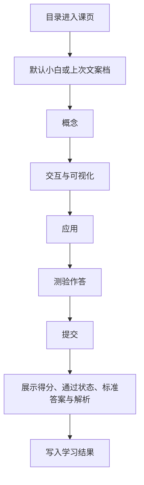

# HTTP 交互式学习（第一批）

## 1. 业务目标

目标用户是自学 HTTP 的人：能读文字，但还没把「一次请求由什么组成、在真实调用里长什么样」对上。本期在 `Izelzzz/interactive-tech-learning` 交付一门 HTTP 课中的 **1 个完整课页**，用一页交互教学验证学习效果。

交互气质对齐参考课页：把概念拆开，从第一性原理讲到实践，并落回真实应用。参考页：<https://study3.aipm.club/wot7WUbXykA7c19NkRDhC/aipm3_1wbTNJQWJrb2szZU8wT2RVZ/05%E6%99%BA%E8%83%BD%E4%BD%93/04Agent%E4%BA%A4%E4%BA%92/sources/index.html>

成功状态（可观察）：

1. 学习者从 HTTP 课程目录进入已发布课页「一次 HTTP 请求」，沿四个区块读完：概念 → 交互/可视化 → 应用 → 测验。
2. 学习者能在页内操作可视化，把样例请求的结构拆开，并看到一次往返。
3. 学习者提交课末测验后，看到每题标准答案、有助于理解处的解析、得分，以及是否通过。
4. 平台可按课标识读取学习结果：课标识、测验是否完成、得分、是否通过。

**已确认**

- 一门课先行：HTTP。课内容由编者写成固定内容后发布；课页渲染的是这份已发布内容。
- 一课一页。页内顺序为概念、交互/可视化、应用、测验。
- 可视化在有助于理解处出现，用成熟开源界面与图表组件实现；允许 shadcn/ui 及同类图表、图示库。
- 课末测验含单选题与简答题。提交后展示标准答案；解析写在有助于辨析的题上。
- 小白 / 专业是同一课页上的两档文案：区块、可视化与题干一套，切换替换讲解句与解析用语。
- 第一批交付 1 个完整课页，先验证这一页的教学效果。
- 课页主体是页眉与教学区块。可视化、操作与测验都落在对应区块里。
- 学习结果至少包含：课标识、测验是否完成、得分、是否通过。

**假设**

- 一页里的原理、可操作可视化、真实对照和带答案测验，足以观察学习者是否建立可用理解。
- 得分与是否通过，能把「交过卷」和「达到通过线」分开。

## 2. 业务结构

### 2.1 角色与场景

| 角色 | 职责 |
|------|------|
| 学习者 | 从目录进入课页，阅读四区块，操作可视化，提交测验并查看答案与得分 |
| 课程编者 | 编写并发布固定课：讲解、可视化数据、应用示例、测验题、标准答案、解析与得分要点 |

场景：学习者打开 HTTP 课程目录，进入「一次 HTTP 请求」，在同一页完成学习与测验。

### 2.2 本期范围

- 一门已发布课程：HTTP。
- 第一批 1 个已发布课页。
- 课程目录列出该课并进入课页。
- 课页四区块按第 2.3 节的顺序排好。
- 页眉提供文案档切换：小白 / 专业。
- 两处可操作可视化：报文结构、一次往返。
- 应用区块用同一条样例对照浏览器请求与 curl。
- 测验：2 道单选 + 1 道简答，提交后给答案、解析、得分与是否通过。
- 学习结果按第 1 节第 4 点保存，并记下提交时的文案档。

### 2.3 信息架构

```text
站点
├── 课程目录（HTTP）
└── 课页（一课一页）
    ├── 页眉：返回目录 | 课名 | 小白/专业 | 四区块入口
    ├── 概念
    ├── 交互 / 可视化
    ├── 应用
    └── 测验
```

页面对象：

| 对象 | 说明 |
|------|------|
| 课程 | 课的归属。第一批为 HTTP，课程标识 `http` |
| 课 | 一个可发布的教学单元。第一批课标识 `http-one-request`，课名「一次 HTTP 请求」 |
| 课页 | 这一课的唯一页面，含四个有序区块 |
| 文案档 | `小白` 或 `专业`。结构共用，讲解句与解析各写一份 |
| 可视化 | 区块内可操作的图示，绑定本课样例数据 |
| 测验 | 单选、简答、分值、通过线、标准答案、解析、简答要点 |
| 学习结果 | 课标识、测验是否完成、得分、是否通过、提交时的文案档 |

### 2.4 界面结构（设计约束）

课页是一条纵向阅读流。学习者看到的主体是页眉和四个教学区块。

| 区域 | 内含 |
|------|------|
| 页眉 | 返回目录；课名；一句学习结果；小白 / 专业切换；四个区块入口（概念、交互、应用、测验），点按后滚到该区块 |
| 概念 | 从第一性原理拆开本课概念，配小白或专业的讲解句 |
| 交互 / 可视化 | 可操作图示与每处一句读图说明 |
| 应用 | 同一条样例在真实调用中的对照，并标出字段 |
| 测验 | 作答区；提交后的得分、是否通过、每题标准答案与解析 |

学习结果一句写在课名下：学完能说明一次请求由什么组成，并能在样例调用里指出方法、目标与 Host。

窄屏下四个区块仍按该顺序纵向排列，可视化在所在区块的宽度内可读、可操作。

### 2.5 主流程



四个区块在同一页同时排好。学习者可以滚动阅读，也可以从页眉进入任一区块。可视化可以逐步查看；查看进度与能否提交测验相互独立。提交后可以修改答案并再次提交，得分与是否通过以最近一次提交为准。

### 2.6 文案档

| 维度 | 小白 | 专业 |
|------|------|------|
| 讲解 | 用动作、地址、附带说明这些日常说法把四部分讲清 | 使用方法、请求目标、首部、正文、Host 等术语 |
| 解析 | 用同一说法解释为何是这个答案 | 用术语指出字段归属 |
| 题干、选项、可视化、区块顺序 | 与专业档相同 | 与小白档相同 |

切换文案档留在当前课页，已填写的答案保留。

### 2.7 第一课内容合同

全课贯穿同一条样例：

- 调用：`GET https://example.com/docs`
- 报文可见：方法 `GET`，目标定位 `example.com` 上的 `/docs`，头 `Host: example.com`
- 这条 GET 可以没有正文

概念区块写清四件事，并说明它们为何要出现在一条请求里：

1. 动作：方法。打开该页面这一次，动作是 GET。
2. 目标：要让对方知道资源在哪。样例要能定位主机 `example.com` 与路径 `/docs`。
3. 附带说明：头。样例带 `Host: example.com`。
4. 附带内容：正文。样例这条 GET 可以没有正文。

概念区块用一两句把路程放回请求旁边：报文到达对方时，中间会找地址、建立连接、在需要时加密。本课的重点是请求报文本身；路程出现在往返可视化的说明里。

交互 / 可视化区块两处，都可操作，并各有一句读图说明：

1. 报文结构：点选方法、目标、头、正文，旁边显示它解决什么、在样例报文里对应哪一段。
2. 一次往返：客户端组成请求 → 请求报文到达服务端 → 服务端返回响应。学习者可逐步查看。

两处都用成熟开源组件呈现。允许 shadcn/ui，以及同类图表与图示库。本课用图示呈现结构与往返。

应用区块并排展示这段样例的两份固化记录，并标出方法、目标、Host：

- 浏览器里的一次请求记录（请求行与 Host）
- 等价命令：`curl https://example.com/docs`

测验在应用区块之后。先作答，提交后展示标准答案；下面三题都附解析。总分 100。通过线 60 分，达到 60 分即为通过。未作答的题按 0 分计，同时展示该题答案与解析。

**单选 1（25 分）**

题干：在一次 HTTP 请求里，表示「这次要做的动作」的部分是哪一个？

- A. 方法（例如 GET）
- B. 响应状态码
- C. 正文
- D. DNS 的查询结果

标准答案：A

解析：方法标明动作。状态码出现在响应里。正文是附带的数据，这条样例 GET 可以没有正文。DNS 负责找到地址，它不是这条请求报文里的动作字段。

**单选 2（25 分）**

题干：样例「打开 https://example.com/docs」里，方法和目标怎样对应？

- A. 方法是 GET，目标要能定位 example.com 上的 /docs
- B. 方法是 TLS，目标是 DNS
- C. 方法是 Host，目标是 GET
- D. 方法是 POST，目标只写 /

标准答案：A

解析：打开页面这一次调用，动作是 GET，目标包含主机 example.com 与路径 /docs。Host 是头，用来标明主机。TLS 与找地址发生在路程中，不是这条请求的方法或目标字段。

**简答（50 分）**

题干：用自己的话写出一条最小 HTTP 请求要交代的三件事。每件事给一个名称，并举一个来自本课样例的例子。样例没有正文时，第三件说明可以没有正文，并举出一个仍然会出现的头。

参考答案：

1. 动作：方法，样例是 GET。
2. 目标：哪个资源，样例是 `https://example.com/docs`（或路径 `/docs` 加上主机 `example.com`）。
3. 附带信息：头或正文。样例 GET 可以没有正文，仍然带有 `Host: example.com`。

简答按要点做包含匹配，大小写不敏感，一个要点只计一次。提交文本命中该要点任一可接受表述，即获得该要点分数。

| 要点 | 分值 | 可接受表述 |
|------|------|------------|
| 动作 | 16 | 方法、GET、动作、要做什么、动词 |
| 目标 | 17 | URL、/docs、example.com、路径、目标、资源、地址、主机 |
| 附带信息 | 17 | Host、头、Header、首部、正文、body、附带、可以没有正文、没有正文 |

课页在提交后展示参考答案全文、命中了哪些要点、得分与是否通过。

## 3. 用户故事

1. 作为初学 HTTP 的人，我希望在一页里从「一次请求要交代什么」读到样例，以便能复述方法、目标、头和正文。
2. 作为已有基础的学习者，我希望同一页换成术语化讲解和解析，以便对齐专业说法。
3. 作为学习者，我希望点选报文、逐步看一次往返，以便把抽象结构看清楚。
4. 作为学习者，我希望看到这条样例在浏览器记录和 curl 里的对应位置，以便知道概念用在哪。
5. 作为学习者，我希望做单选和简答，提交后看到答案、解析、得分和是否通过，以便核对学会了没有。
6. 作为课程编者，我希望用固定内容配置四区块和测验答案，以便这一课可以重复发布。

## 4. 功能清单

| 能力 | 业务规则 | 故事 |
|------|----------|------|
| 目录进入 | 目录列出已发布的 HTTP 课。第一批进入「一次 HTTP 请求」课页 | 1–6 |
| 四区块课页 | 同一页按概念、交互/可视化、应用、测验排列。页眉入口滚到对应区块 | 1、3、4、5 |
| 文案档切换 | 页眉切换小白/专业，立即替换讲解句与解析。题干、选项、可视化与已填答案保留 | 1、2 |
| 可视化 | 报文结构可点选；往返可逐步查看。每处有一句读图说明。用开源 UI / 图示 / 图表组件实现，允许 shadcn/ui 及同类库 | 3 |
| 应用对照 | 展示第 2.7 节样例的浏览器记录与 curl，并标出方法、目标、Host | 4 |
| 测验提交 | 两道单选与一道简答按第 2.7 节计分。提交后展示标准答案、解析、得分、是否通过。再次提交覆盖得分与是否通过 | 5 |
| 结果记录 | 保存课标识、测验是否完成、得分、是否通过、提交时的文案档。有过一次提交后，测验完成为是 | 5、6 |

## 5. 边界与异常

| 情形 | 业务预期 |
|------|----------|
| 课已发布 | 目录出现「一次 HTTP 请求」，进入第 2.7 节的课页 |
| 课未发布 | 目录只列出已发布课 |
| 测验尚未提交 | 四个区块都可阅读；该课测验完成为否 |
| 某题未作答就提交 | 该题记 0 分，并展示标准答案与解析；已作答的题照常计分 |
| 简答未命中任何要点 | 简答记 0 分，并展示参考答案与解析 |
| 得分低于 60 | 测验完成为是，是否通过为否，展示实际得分 |
| 得分达到或超过 60 | 是否通过为是 |
| 切换文案档 | 讲解与解析改为所选档；题干、可视化与已填内容保留 |
| 首次打开 | 文案档为小白 |
| 离开后返回 | 打开同一课页，文案档恢复为上次所选；已有提交则展示最近一次得分、通过状态、答案与解析 |
| 窄屏 | 四区块纵向排列；两处可视化在区块内可读、可操作 |

## 6. 验收标准

1. 学习者可从 HTTP 目录进入已发布课「一次 HTTP 请求」，同一页按顺序包含概念、交互/可视化、应用、测验，且样例 `GET https://example.com/docs` 贯穿这三块教学内容。（故事 1、3、4）
2. 报文结构可点选方法、目标、头、正文；往返可逐步查看客户端发出请求到服务端返回响应。两处都有读图说明。（故事 3）
3. 切换小白 / 专业后，当前讲解句与测验解析改为对应档，题干、选项、可视化与已填答案保留。（故事 1、2）
4. 提交测验后可见第 2.7 节三题的标准答案与解析、满分 100 的得分，以及是否达到 60 分通过线。未作答题按 0 分计。简答按该节要点与可接受表述计分。（故事 5）
5. 提交后可读取课标识 `http-one-request`、测验已完成、得分、是否通过、提交时的文案档。再次提交后，得分与是否通过为最近一次。（故事 5、6）
6. 课页主体为页眉加四个教学区块；可视化与测验出现在各自区块内。（设计约束）
7. 第 5 节各情形的业务预期，即为该情形的验收。

## 7. 术语表

| 术语 | 含义 | 在本期中 | 边界 |
|------|------|----------|------|
| 课程 | 一组已发布的课 | HTTP，标识 `http` | 第一批一门课 |
| 课页 | 一课对应的一张交互教学页 | 「一次 HTTP 请求」，标识 `http-one-request` | 第一批一页 |
| 概念区块 | 用第一性原理拆开本课概念 | 方法、目标、头、正文，以及它们为何存在 | 课页第一节 |
| 交互区块 | 用可操作图示把概念拆开 | 报文点选与一次往返 | 紧随概念 |
| 应用区块 | 把同一概念对上真实调用 | 浏览器记录与 curl 对照 | 紧随交互 |
| 测验 | 课末单选与简答 | 提交后给答案、解析、得分、是否通过 | 紧随应用 |
| 文案档 | 同一结构下的讲解深度 | 小白、专业 | 切换留在当前课页 |
| 学习结果 | 一课的测验记录 | 课标识、是否完成、得分、是否通过、文案档 | 以最近一次提交为准 |
| 通过 | 得分达到该课通过线 | 第一课 60 分 | 与得分同时可读 |

## 8. 决策日志

| 时间 | 变更点 | 理由 | 决策人 |
|------|--------|------|--------|
| 2026-10-17 | 固定课、双版本、HTTP 先行；两套讲解分开维护 | 验证交互相对纯文是否更有效 | Izel |
| 2026-10-18 | 采用「请求当主角」+ 组包即测验 + 同屏模式切换 | 隐喻清晰、练习像真干活 | Izel |
| 2026-10-18 | UI 一屏主块 ≤2：舞台为主，组包步才出组包条；顶栏保留小白/专业 | 降复杂度，保留深度切换 | Izel |
| 2026-10-18 | 规格补信息架构与界面结构，供工程实现对照 | 工程可读、设计可验收 | Izel / 福尔摩斯 |
| 2026-10-17 | 仓库 `Izelzzz/interactive-tech-learning` | 独立承载本产品 | Izel |
| 2026-10-18 | 第一批交付 1 个完整单元路径 | 先以一条完整单元路径验证学习效果 | Izel |
| 2026-10-18 | 故障路径某一坑可跳过 | 跳过记为已跳过并进入下一步，路径仍可走到结束回放 | Izel |
| 2026-10-18 | 放弃「请求当主角」舞台、组包条、故障路径（含跳过）作为主信息架构，改为课程目录 → 课页 | 隐喻路径与一课一页的教学阅读冲突；效果改为读完教学区块并完成带答案的测验 | Izel / 福尔摩斯 |
| 2026-10-18 | 采用一课一页：概念 → 交互/可视化 → 应用 → 测验。可视化使用 shadcn/ui 等开源组件与图表库。测验为单选加简答，提交后给出标准答案与解析 | 对齐参考课页：拆开概念，从第一性原理讲到实践，并落回真实应用 | Izel / 福尔摩斯 |
| 2026-10-18 | 小白/专业保留为同一课页的文案深度；区块、可视化与题干一套 | 只替换讲解句与解析，课页保持一条教学流。若以后需要两套版式，再改为单一教学声部 | Izel / 福尔摩斯 |
| 2026-10-18 | 第一批仍为 1 个完整课页「一次 HTTP 请求」。学习结果含课标识、测验是否完成、得分、是否通过 | 先用一页验证教学效果 | Izel / 福尔摩斯 |
