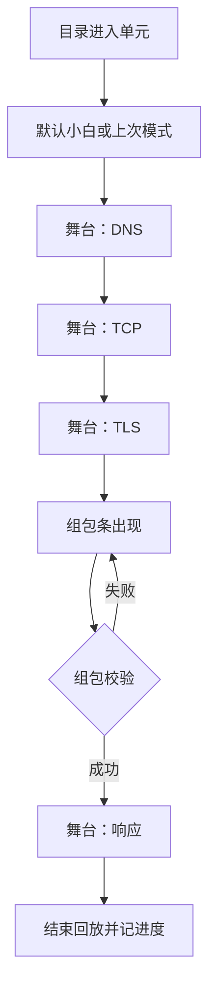

# HTTP 交互式学习（第一批）

## 1. 业务目标

目标用户是自学 HTTP / 网络的人：能读文字，但难把「一次请求在链路上怎么走」对上。本期在 `Izelzzz/interactive-tech-learning` 第一批交付 1 个完整单元路径，用可交互讲解替代纯静态长文，先验证学习效果。

成功状态（可观察）：

1. 学习者选定「小白」或「专业」模式后，能完成该单元的一条完整路径：DNS → TCP → TLS → 组包发送 → 响应。
2. 在组包步骤提交发送时，合法请求进入响应；非法组合有明确失败反馈并可重试。正常路径须校验通过后进入响应。
3. 同一单元可进入故障路径。某一坑可跳过；修通或跳过后继续，结束时可回看各步结果：通过、已跳过或失败。
4. 平台记录：单元、模式、路径（正常 / 故障）、是否完课、组包是否一次成功。走到结束回放记为完课；故障路径含修通与允许的跳过。

**已确认**

- 课程内容固定编写；学习者提问不生成整课。
- 小白 / 专业为同一大纲下的两种讲解深度；顶栏保留模式切换。
- 学习隐喻：学习者扮演「这一次 HTTP 请求」沿链路前进。
- 练习形态：组包即测验（拼请求，通过才继续）。
- UI 原则：一屏主视野最多两个主区域（舞台；组包步骤才出现组包条）。
- 第一批主题：HTTP / 网络。
- 第一批交付 1 个完整单元路径，先验证学习效果。
- 故障路径某一坑可跳过；该步记为已跳过并进入下一步。

**假设**

- 轻量交互足以支撑隐喻；重动画非本期成功条件。
- 「完课 + 组包一次成功率」可与纯文字材料对照学习效果。

## 2. 业务结构

### 2.1 角色与场景

| 角色 | 职责 |
|------|------|
| 学习者 | 选模式、走正常或故障路径、组包、跳过故障坑、看结果 |
| 课程编者 | 编写固定单元的步骤文案、组包规则、故障关卡 |

场景：学习者打开已发布的 HTTP 单元，完成一条路径上的讲解与组包练习。

### 2.2 本期范围

- 第一批交付 1 个完整单元路径：一门 HTTP 课、1 个已发布单元，含正常路径与故障路径。
- 课程目录展示该已发布单元。
- 单元页：正常路径、故障路径。
- 顶栏模式：小白 / 专业（同屏切换，不换页）。
- 舞台推进：DNS → TCP → TLS → 组包 → 响应。
- 组包练习：Method、Path、Host 等必要字段拼装；校验通过后发送。
- 故障关卡：DNS / TCP / TLS / 组包 / 响应侧至少各可配置一类失败与修复动作；某一坑可跳过。
- 单元结束回放：各步结果为通过、已跳过或失败。
- 学习结果记录（见目标第 4 点）。

### 2.3 信息架构

```text
站点
├── 课程目录（HTTP）
└── 单元页
    ├── 顶栏：单元标题 | 小白/专业
    ├── 舞台（默认主视野）
    ├── 组包条（仅组包步骤显示）
    ├── 路径入口：正常 | 故障（弱入口，不与主视野抢视线）
    └── 结束回放
```

页面对象：

| 对象 | 说明 |
|------|------|
| 课程 | 单元的归属；第一批发布 1 个单元 |
| 单元 | 含正常路径、故障路径 |
| 路径 | 有序步骤列表 |
| 步骤 | 类型：讲解推进 \| 组包 \| 故障修复；含小白文案、专业文案、成功/失败条件；故障修复步可记已跳过 |
| 组包规则 | 必填字段与合法组合；失败原因文案（双模式各一份） |

### 2.4 界面结构（设计约束）

**一屏原则：** 学习者同时注意到的主块 ≤ 2。

| 区域 | 何时出现 | 内含 |
|------|----------|------|
| 顶栏 | 始终 | 标题；小白 / 专业切换（仅此一个模式控件） |
| 舞台 | 始终 | 当前步状态；主操作「下一步」「重试」，故障坑另有「跳过」；当前步一句主文案（随模式变） |
| 组包条 | 仅组包步骤 | Method、Path、Host（及该步规定字段）；「发送」；失败时一行原因 |

明确收起（不进入默认主视野）：完整五步进度条、正常/故障大开关并排、旁白栏与专业面板双栏同屏、图例说明。专业信息在「专业」模式下并入舞台主文案或组包旁一行字段提示，不另开第三主块。

### 2.5 主流程



故障路径：同序步骤，每步可配置失败态。学习者完成修复动作后进入下一步。某一坑可跳过：选择跳过后，该步记为已跳过并进入下一步。跳过组包坑后进入响应步。修通或跳过均可走到结束回放。

### 2.6 模式差异（业务）

| 维度 | 小白 | 专业 |
|------|------|------|
| 文案 | 过程隐喻、少术语 | 术语、关键字段与状态含义 |
| 组包失败提示 | 人话原因 | 指出缺失/非法字段 |
| 交互壳 | 同一舞台与组包条 | 同一舞台与组包条 |

## 3. 用户故事

1. 作为小白学习者，我希望用通俗说明沿 DNS→…→响应走完一次请求，以便建立过程心智模型。
2. 作为有基础的学习者，我希望同一路径上看到术语与字段级反馈，以便对齐真实排障语言。
3. 作为学习者，我希望在组包步自己拼请求且错了能改，以便确认「什么叫合法请求」。
4. 作为学习者，我希望走故障路径，修复失败或跳过某一坑，以便把链路走完并看到断点。
5. 作为课程编者，我希望按步骤配置双模式文案与组包/故障规则，以便固定课可复用同一壳。

## 4. 功能清单

| 能力 | 业务规则 | 故事 |
|------|----------|------|
| 目录进入 | 仅展示已发布 HTTP 单元；进入后到单元页 | 1–5 |
| 模式切换 | 顶栏切换小白/专业；立即替换当前步文案与失败提示；不重置已完成步骤 | 1、2 |
| 舞台推进 | 非组包步用「下一步」前进；失败态用「重试」；故障坑提供「跳过」，跳过后进入下一步 | 1、2、4 |
| 组包练习 | 组包步显示组包条；校验通过后进入响应；失败保留已填项并显示一行原因。正常路径须校验通过。故障路径的组包坑可跳过，跳过后进入响应步 | 3、4 |
| 正常路径 | 默认路径；步骤顺序固定为 DNS→TCP→TLS→组包→响应 | 1、2 |
| 故障路径 | 可从单元进入；步骤可配置失败与修复成功条件；某一坑可跳过，跳过后该步记为已跳过并进入下一步 | 4 |
| 结束回放 | 列出各步通过、已跳过或失败；写入学习结果 | 4、5 |
| 结果记录 | 记录单元、模式、路径类型、完课、组包是否一次成功 | 5 |

## 5. 边界与异常

| 情形 | 业务预期 |
|------|----------|
| 未发布单元 | 目录不可见 |
| 组包缺必填或非法组合 | 不进入响应；一行失败原因；可改后重发 |
| 故障步未修复 | 留在本步；可重试，也可跳过 |
| 故障步跳过 | 该步记为已跳过并进入下一步；路径可走到结束回放 |
| 切换模式 | 文案与提示切换；步骤进度保留 |
| 中断离开后返回 | 回到该单元上次步骤（若已有进度） |
| 小屏 | 仍为舞台为主；组包条在组包步出现在舞台下方，可纵向滚动 |

## 6. 验收标准

1. 学习者可从目录进入已发布单元，在小白或专业模式下走完正常路径五步（含一次成功组包）。（故事 1–3）
2. 模式切换后，当前步文案与组包失败提示随模式变化，步骤进度不丢。（故事 1、2）
3. 提交发送时，组包非法留在组包步并给出一行原因；修正后进入响应。故障路径跳过组包坑后进入响应步。（故事 3、4）
4. 故障路径至少包含一种可修复失败。修复后可继续至结束回放；某一坑选择跳过后同样可继续至结束回放，回放中该步为已跳过。（故事 4）
5. 完课后代可读取第 1 节成功状态第 4 点所列记录字段。（故事 5）
6. 默认主视野在非组包步仅顶栏+舞台；组包步为顶栏+舞台+组包条。（设计约束）
7. 第 5 节各情形预期即为该情形验收。

## 7. 术语表

| 术语 | 含义 | 不包括 | 边界 |
|------|------|--------|------|
| 请求当主角 | 学习者沿一次请求的链路步骤前进 | 多请求并发仿真 | 第一批单请求 |
| 舞台 | 当前步主视觉与主操作区 | 组包字段编辑区 | 始终存在 |
| 组包条 | 拼装并发送请求的编辑区 | 完整 DevTools | 仅组包步显示 |
| 小白 / 专业 | 讲解与提示深度 | 两门不同课程 | 同大纲同壳 |
| 正常路径 | 无预设坑的标准链路 | 随机网络噪声 | 默认进入 |
| 故障路径 | 预设失败与修复的链路；某一坑可跳过，跳过记为已跳过 | 生产事故演练全量 | 单元内入口 |
| 完课 | 当前路径走到结束回放；故障路径含修通与允许的跳过 | 仅打开页面 | 与结果记录一致 |

## 8. 决策日志

| 时间 | 变更点 | 理由 | 决策人 |
|------|--------|------|--------|
| 2026-10-17 | 固定课、双版本、HTTP 先行；两套讲解分开维护 | 验证交互相对纯文是否更有效 | Izel |
| 2026-10-18 | 采用「请求当主角」+ 组包即测验 + 同屏模式切换 | 隐喻清晰、练习像真干活 | Izel |
| 2026-10-18 | UI 一屏主块 ≤2：舞台为主，组包步才出组包条；顶栏保留小白/专业 | 降复杂度，保留深度切换 | Izel |
| 2026-10-18 | 规格补信息架构与界面结构，供工程实现对照 | 工程可读、设计可验收 | Izel / 福尔摩斯 |
| 2026-10-17 | 仓库 `Izelzzz/interactive-tech-learning` | 独立承载本产品 | Izel |
| 2026-10-18 | 第一批交付 1 个完整单元路径 | 先以一条完整单元路径验证学习效果 | Izel |
| 2026-10-18 | 故障路径某一坑可跳过 | 跳过记为已跳过并进入下一步，路径仍可走到结束回放 | Izel |
