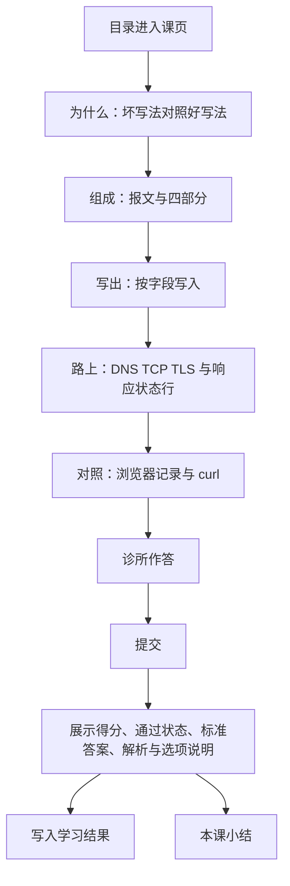

# HTTP 交互式学习（第一批）

## 1. 业务目标

目标用户是自学 HTTP 的人：能读文字，但还没把「一次请求由什么组成、在真实调用里长什么样」对上。本期在 `Izelzzz/interactive-tech-learning` 交付一门 HTTP 课中的 **1 个完整课页**，用一页交互教学验证学习效果。

课页按问题往下读。每一节只回答一个问题。坏写法与好写法先对照，正法紧跟其后。实验和动画出现在对应原则之后，开场说明观察什么。版式使用 shadcn/ui：居中栏、白底卡片、细边框、带标题和复制的 Code Block。组装、往返和字段标出由脚本按时间推进。

成功状态（可观察）：

1. 学习者从 HTTP 课程目录进入已发布课页「读懂一次 HTTP 请求」，沿六段读完：为什么 → 组成 → 写出 → 路上 → 对照 → 诊所与小结。
2. 学习者能指出方法、目标与 Host，把 DNS、TCP、TLS 归到路上，并在浏览器记录和 curl 里互指同一字段。
3. 学习者提交课末诊所后，看到每题标准答案、解析、每个选项的说明、得分，以及是否通过。
4. 平台可按课标识读取学习结果：课标识、测验是否完成、得分、是否通过。

**已确认**

- 一门课先行：HTTP。课内容由编者写成固定内容后发布；课页渲染的是这份已发布内容。
- 一课一页。页内顺序为为什么、组成、写出、路上、对照、诊所。小结清单跟在诊所后面。
- 课页使用一套专业、可核对的中文。每段只推进一步。术语在第一次出现时用一句话说明它是什么。
- 全程同一条样例：`GET https://example.com/docs`。
- 可视化在原则立住之后出现，并说明要观察什么。界面使用 shadcn/ui。请求报文、curl 与终端样例使用带标题和复制的 Code Block。
- 组装请求、往返追踪和字段标出由脚本按时间推进，操作后立刻换上这一步的判断。
- 课末是诊所式测验：单选题与简答题。提交后在原处展示标准答案、解析、每个选项的说明、得分与是否通过。
- 第一批交付 1 个完整课页，先验证这一页的教学效果。
- 课页主体是页眉、开篇和六段教学。可视化、操作与测验都落在对应段里。
- 学习结果至少包含：课标识、测验是否完成、得分、是否通过。作答与简答命中要点随结果保留，返回课页时填回作答区并展示命中要点。

**假设**

- 一页里先对照坏写法与好写法，再给报文、可操作演示、真实对照和带答案诊所，足以观察学习者是否建立可用理解。
- 得分与是否通过，能把「交过卷」和「达到通过线」分开。

## 2. 业务结构

### 2.1 角色与场景

| 角色 | 职责 |
|------|------|
| 学习者 | 从目录进入课页，沿六段阅读，操作演示，提交诊所并查看答案与得分 |
| 课程编者 | 编写并发布固定课：判断句、演示数据、对照示例、测验题、选项说明、标准答案、解析与得分要点 |

场景：学习者打开 HTTP 课程目录，进入「读懂一次 HTTP 请求」，在同一页完成学习与测验。

### 2.2 本期范围

- 一门已发布课程：HTTP。
- 第一批 1 个已发布课页。
- 课程目录列出该课并进入课页。
- 课页六段按第 2.3 节的顺序排好。
- 一套讲解与解析。术语在第一次出现时用一句话说明。
- 两处可操作演示：按字段写出请求、按时间追踪一次往返。两处都出现在对应原则之后。
- 对照段用同一条样例对照浏览器请求与 curl，点字段后两边同时标出。
- 诊所：2 道单选 + 1 道简答，提交后给答案、解析、每个选项的说明、得分与是否通过。
- 小结：4–6 条可带走规则，以及 MDN《HTTP 概述》链接。
- 学习结果按第 1 节第 4 点保存，并保留作答与简答命中要点。

### 2.3 信息架构

```text
站点
├── 课程目录（HTTP）
└── 课页（一课一页）
    ├── 页眉：返回目录 | 课名 | 六段短名
    ├── 开篇：这一课回答什么 + 学完你能
    ├── 为什么要把请求拆开看
    ├── 第一步：一条请求要交代什么
    ├── 实验：按字段写出这条请求
    ├── 第二步：路上发生了什么
    ├── 第三步：浏览器记录和 curl 怎样对上
    └── 诊所 + 本课小结
```

页眉短名与章节一致：为什么、组成、写出、路上、对照、诊所。

页面对象：

| 对象 | 说明 |
|------|------|
| 课程 | 课的归属。第一批为 HTTP，课程标识 `http` |
| 课 | 一个可发布的教学单元。第一批课标识 `http-one-request`，课名「读懂一次 HTTP 请求」 |
| 课页 | 这一课的唯一页面，含开篇和六个有序章节 |
| 讲解 | 全课一套。判断句、题干、选项、演示与解析使用同一套中文 |
| 可视化 | 原则之后可操作的演示，绑定本课样例数据 |
| 诊所 | 单选、简答、分值、通过线、标准答案、解析、每个选项的说明、简答要点 |
| 学习结果 | 课标识、测验是否完成、得分、是否通过；作答与命中要点随结果保留 |

### 2.4 界面结构（设计约束）

课页是一条纵向阅读流。学习者看到的主体是页眉、开篇和六个章节。版式为居中栏、白底卡片、细边框、约 16px 圆角。正文栏约 46rem。章节标题是问题或步骤。坏写法与好写法两栏对照，上沿分别用警示色和强调色。判断句用左侧色条 callout。请求、curl 与终端样例放在带标题和复制按钮的代码块里。

| 区域 | 内含 |
|------|------|
| 页眉 | 返回目录；课名；六个短名入口（为什么、组成、写出、路上、对照、诊所），点按后滚到该章。页眉随内容增高，入口保持可点 |
| 开篇 | 眉题、课名、一句「这一课回答什么」、学完你能 |
| 为什么 | 坏写法与好写法两栏，随后是判断句和「状态码 ≠ 请求方法」 |
| 组成 | 先给完整样例报文，再给「部分 / 回答的问题 / 本课样例」表，然后是「正文可以空。Host 仍然要有。」和「报文字段 ≠ 路上的步骤」 |
| 写出 | 开场说明观察什么，然后按字段写入报文。右侧说明推进这一段的判断 |
| 路上 | 先用几句讲清 DNS、TCP、TLS 在路上，再追踪往返，并说明观察报文区何时换成响应状态行 |
| 对照 | 同一调用的浏览器记录与 curl。点表格行，两边同步标出。写明 curl 省略 -X 时默认 GET |
| 诊所 | 整行选项与简答；提交后的得分、是否通过、每题标准答案、解析，以及每个选项的说明 |
| 小结 | 4–6 条可带走规则，以及 MDN 链接 |

开篇写明：这一课回答「打开一个网址时，客户端到底发出了什么」。学完你能指出方法、目标与 Host；把 DNS/TCP/TLS 归到路上；在浏览器记录与 curl 之间互指同一字段。

窄屏下六段仍按该顺序纵向排列。页眉入口换行后仍可点。对照改为上下排列。演示留在所在章节的宽度内，可读、可操作。

### 2.5 主流程



六个章节在同一页同时排好。学习者可以滚动阅读，也可以从页眉进入任一章。演示可以逐步查看；查看进度与能否提交测验相互独立。提交后可以修改答案并再次提交，得分与是否通过以最近一次提交为准。

### 2.6 讲解

全课一套中文。方法、头、DNS、TCP、TLS、状态码在第一次出现时，用一句话说明它是什么。每条原则是一句可带走的判断。实验旁的说明推进这一步的判断，并指出常见认错。

| 维度 | 这一套讲解 |
|------|------------|
| 讲解 | 使用方法、目标、头、正文、Host 等术语，并在首次出现时说明 |
| 解析 | 用同一套术语指出字段归属。每个单选选项各有一句说明 |
| 题干、选项、演示、章节顺序 | 全课共用这一套 |

### 2.7 第一课内容合同

全课贯穿同一条样例：

- 调用：`GET https://example.com/docs`
- 报文可见：方法 `GET`，目标定位 `example.com` 上的 `/docs`，头 `Host: example.com`
- 这条 GET 的正文是空的。Host 仍然要有

**为什么要把请求拆开看**

坏写法：把整次访问当成黑盒；把 200 当成请求里的动作；把 DNS 写成请求字段。

好写法：方法说动作，样例是 GET；路径 `/docs` 加上 `Host: example.com` 说目标；头附带说明；状态码只出现在响应里。

callout：状态码 ≠ 请求方法。200 写在响应的状态行上。GET 写在请求行的开头。

**第一步：一条请求要交代什么**

先展示报文：

```text
GET /docs HTTP/1.1
Host: example.com
```

表：

| 部分 | 回答的问题 | 本课样例 |
|------|------------|----------|
| 方法 | 这次要做什么？ | GET |
| 目标 | 要的资源在哪？ | /docs，主机 example.com |
| 头 | 还要附带什么说明？ | Host: example.com |
| 正文 | 要不要带一段数据？ | 这条 GET 没有正文 |

规则：正文可以空。Host 仍然要有。

callout：报文字段 ≠ 路上的步骤。DNS 解析地址，TCP 建立连接，TLS 为 HTTPS 加密。三步都在路上，不占方法、目标、头、正文的位置。

**实验：按字段写出这条请求**

开场：点播放，按时间写入字段；写到哪一段，右侧换成这一段的说明。也可以点字段名跳转。

右侧判断依次推进：GET 把动作定成取回，它与 200、DNS 各管一件事；`/docs` 只写出路径，主机留给 Host；Host 补上 `example.com`，请求行末尾的 HTTP/1.1 是协议版本；正文空着时请求已经写完，Host 仍在。

**第二步：路上发生了什么**

先说明：报文离开客户端之后，DNS 把 example.com 解析成地址，TCP 把两端连上，TLS 为 HTTPS 加密。这三步都在路上，不写入方法、路径、Host 或正文。服务端读完请求，才在响应的状态行写下状态码。

然后追踪往返。开场：观察包从客户端到服务端再回来时，报文区何时换成响应状态行。三站依次是客户端组成请求、请求在路上、服务端返回响应。到达终点后，状态为已到达。报文包停在站点芯片上方，两者同时可读。响应站的报文是 `HTTP/1.1 200 OK`。

**第三步：浏览器记录和 curl 怎样对上**

并排展示：

- 浏览器里的一次请求记录（请求行 `GET /docs HTTP/1.1` 与 `Host: example.com`）
- 等价命令：`curl https://example.com/docs`，以及它发出的同一条请求。命令与请求行之间是连续行

curl 省略 `-X` 时默认 GET，发出的请求行仍以 GET 开头。点表格中的一行，两边同时标出方法、目标或 Host。

**诊所与小结**

测验在对照之后。选项是整行按钮。选择后立刻显示已选哪一项；提交后在原处展示标准答案、解析和每个选项的说明，并把选对的项和选错的项区分开。总分 100。通过线 60 分，达到 60 分即为通过。未作答的题按 0 分计，同时展示该题答案与解析。单选选项等长，两题的正确项分别落在不同位置。

**单选 1（25 分）**

题干：打开 https://example.com/docs 时，有人用 200 描述这次请求的动作。动作实际对应哪一项？

- A. 响应里带回的状态码。说明：状态码写在响应的状态行上，不在请求里标明动作。
- B. 请求里标明的方法名。说明：方法写在请求行开头。样例是 GET，它标明这次要取回资源。
- C. 请求附带的那段正文。说明：正文是附带数据。这条 GET 可以没有正文，请求仍然完整。
- D. 路上查找地址的步骤。说明：DNS 在路上查找地址，不占方法、目标、头或正文。

标准答案：B

解析：动作是请求里的方法，样例是 GET。200 是响应里的状态码。

**单选 2（25 分）**

题干：有人把样例记成「方法是 Host，目标是 GET」。方法和目标怎样才对？

- A. 方法为TLS，目标交给DNS。说明：TLS 加密通路，DNS 解析主机。两者都在路上，不是方法和目标。
- B. 方法Host，目标写成GET。说明：Host 是头，GET 是方法。这句把两者对调了。
- C. 方法GET，目标是/docs。说明：方法是 GET，目标的路径是 /docs。主机写在 Host: example.com。
- D. 方法POST，目标写成网站根。说明：这条样例不是 POST，目标也不是网站根。

标准答案：C

解析：方法是 GET，目标要能定位路径 /docs。Host 是头。TLS 与 DNS 发生在路上。

**简答（50 分）**

题干：用自己的话写出一条最小 HTTP 请求要交代的三件事。每件事给一个名称，并举一个来自本课样例的例子。样例没有正文时，第三件说明可以没有正文，并举出一个仍然会出现的头。

参考答案：

1. 动作：方法，样例是 GET。
2. 目标：哪个资源，样例是 `https://example.com/docs`（或路径 `/docs` 加上主机 `example.com`）。
3. 附带信息：头或正文。样例 GET 可以没有正文，仍然带有 `Host: example.com`。

简答按要点做包含匹配，大小写不敏感，一个要点只计一次。提交文本命中该要点任一可接受表述，即获得该要点分数。

| 要点 | 分值 | 可接受表述 |
|------|------|------------|
| 动作 | 16 | 方法、GET、动作、要做什么、动词 |
| 目标 | 17 | URL、/docs、example.com、路径、目标、资源、地址、主机 |
| 附带信息 | 17 | Host、头、Header、首部、正文、body、附带、可以没有正文、没有正文 |

课页在提交后展示参考答案全文、命中了哪些要点、得分与是否通过。

小结 5 条：方法说动作，样例是 GET，状态码写在响应里；目标是路径 `/docs` 加上 `Host: example.com`；正文可以空，Host 仍然要有；DNS、TCP、TLS 在路上；浏览器记录和 curl 是同一条请求的两种写法，curl 省略 `-X` 时默认 GET。

课页在小结之后给出 MDN《HTTP 概述》链接，并写明读完仍有疑问可以直接问。

## 3. 用户故事

1. 作为初学 HTTP 的人，我希望先看到坏写法和好写法，再读方法、目标、头和正文，以便能指出一次请求由什么组成。
2. 作为学习者，我希望术语在第一次出现时用一句话说明，以便顺着同一套说法往下读。
3. 作为学习者，我希望在原则之后按字段写出报文、再追踪一次往返，以便看见字段怎样写上、状态码出现在哪一站。
4. 作为学习者，我希望看到这条样例在浏览器记录和 curl 里的对应位置，以便互指同一字段。
5. 作为学习者，我希望做诊所里的单选和简答，提交后看到答案、每个选项的说明、解析、得分和是否通过，以便核对有没有认错字段。
6. 作为课程编者，我希望用固定内容配置六段叙事和测验答案，以便这一课可以重复发布。

## 4. 功能清单

| 能力 | 业务规则 | 故事 |
|------|----------|------|
| 目录进入 | 目录列出已发布的 HTTP 课。第一批进入「读懂一次 HTTP 请求」课页 | 1–6 |
| 六段课页 | 同一页按为什么、组成、写出、路上、对照、诊所排列，小结跟在诊所后。页眉短名滚到对应章 | 1、3、4、5 |
| 一套讲解 | 讲解与解析使用同一套中文。每段推进一个判断。术语第一次出现时用一句话说明 | 1、2 |
| 可视化 | 组成规则之后，组装请求按时间写入字段；路上说明之后，往返按时间移动报文包。点选后立刻显示该步判断。样例放在 Code Block 中 | 3 |
| 对照 | 展示第 2.7 节样例的浏览器记录与 curl，点字段后两边同时标出方法、目标、Host。写明 curl 省略 -X 时默认 GET | 4 |
| 诊所提交 | 两道单选与一道简答按第 2.7 节计分。提交后展示标准答案、解析、每个选项的说明、得分、是否通过。再次提交覆盖得分与是否通过 | 5 |
| 结果记录 | 保存课标识、测验是否完成、得分、是否通过，并保留作答与命中要点。有过一次提交后，测验完成为是 | 5、6 |

## 5. 边界与异常

| 情形 | 业务预期 |
|------|----------|
| 课已发布 | 目录出现「读懂一次 HTTP 请求」，进入第 2.7 节的课页 |
| 课未发布 | 目录只列出已发布课 |
| 测验尚未提交 | 六个章节都可阅读；该课测验完成为否 |
| 某题未作答就提交 | 该题记 0 分，并展示标准答案与解析；已作答的题照常计分 |
| 简答未命中任何要点 | 简答记 0 分，并展示参考答案与解析 |
| 得分低于 60 | 测验完成为是，是否通过为否，展示实际得分 |
| 得分达到或超过 60 | 是否通过为是 |
| 首次打开 | 组装停在可播放的报文预览，往返停在客户端组成请求，测验尚未提交 |
| 离开后返回 | 已有提交则展示最近一次得分、通过状态、答案、解析与选项说明，作答区填回该次答案 |
| 窄屏 | 六段纵向排列；页眉入口换行后仍可点；对照的两份记录上下排列；演示在章节内可读、可操作 |

## 6. 验收标准

1. 学习者可从 HTTP 目录进入已发布课「读懂一次 HTTP 请求」。同一页按顺序包含为什么、组成、写出、路上、对照、诊所与小结。样例 `GET https://example.com/docs` 贯穿这些章节。（故事 1、3、4）
2. 组装请求可按时间写入方法、目标、头、正文，点选后立刻显示对应判断。往返可按时间查看客户端组成请求、请求在路上、服务端返回响应。两处都在原则之后，并有观察说明。样例出现在带复制的代码块中。往返终点显示已到达，报文包停在站点芯片上方。（故事 3）
3. 课页讲解与解析是一套。方法、头、DNS、TCP、TLS、状态码在课页中第一次出现时有一句说明。状态码与请求方法、报文字段与路上步骤，各有一条 callout。（故事 1、2）
4. 提交测验后可见第 2.7 节三题的标准答案与解析、每个选项的说明、满分 100 的得分，以及是否达到 60 分通过线。未作答题按 0 分计。简答按该节要点与可接受表述计分。（故事 5）
5. 提交后可读取课标识 `http-one-request`、测验已完成、得分、是否通过。再次提交后，得分与是否通过为最近一次。作答与命中要点随结果保留。（故事 5、6）
6. 课页主体为页眉、开篇和六个章节；可视化出现在写出与路上，测验出现在诊所内。（设计约束）
7. 第 5 节各情形的业务预期，即为该情形的验收。

## 7. 术语表

| 术语 | 含义 | 在本期中 | 边界 |
|------|------|----------|------|
| 课程 | 一组已发布的课 | HTTP，标识 `http` | 第一批一门课 |
| 课页 | 一课对应的一张交互教学页 | 「读懂一次 HTTP 请求」，标识 `http-one-request` | 第一批一页 |
| 为什么 | 用坏写法与好写法引出拆开请求的理由 | 状态码留在响应，方法写在请求行 | 课页第一节 |
| 组成 | 用报文和表交代方法、目标、头、正文 | 同一条样例报文 | 紧随为什么 |
| 写出 | 原则之后按字段写入这条请求 | 组装请求 | 紧随组成 |
| 路上 | 原则之后追踪 DNS、TCP、TLS 与响应状态行 | 一次往返 | 紧随写出 |
| 对照 | 把同一请求对上浏览器记录与 curl | 方法、目标、Host | 紧随路上 |
| 诊所 | 课末单选与简答 | 提交后给答案、选项说明、解析、得分、是否通过 | 紧随对照 |
| 小结 | 可带走的规则清单 | 4–6 条，加 MDN 链接 | 紧随诊所 |
| 讲解 | 全课一套中文 | 术语首次出现时用一句话说明 | 题干与演示共用这一套 |
| 学习结果 | 一课的测验记录 | 课标识、是否完成、得分、是否通过 | 以最近一次提交为准 |
| 通过 | 得分达到该课通过线 | 第一课 60 分 | 与得分同时可读 |

## 8. 决策日志

| 时间 | 变更点 | 理由 | 决策人 |
|------|--------|------|--------|
| 2026-10-17 | 固定课、双版本、HTTP 先行；两套讲解分开维护 | 验证交互相对纯文是否更有效 | Izel |
| 2026-10-18 | 采用「请求当主角」+ 组包即测验 + 同屏模式切换 | 隐喻清晰、练习像真干活 | Izel |
| 2026-10-18 | UI 一屏主块 ≤2：舞台为主，组包步才出组包条；顶栏保留小白/专业 | 降复杂度，保留深度切换 | Izel |
| 2026-10-18 | 规格补信息架构与界面结构，供工程实现对照 | 工程可读、设计可验收 | Izel / 福尔摩斯 |
| 2026-10-17 | 仓库 `Izelzzz/interactive-tech-learning` | 独立承载本产品 | Izel |
| 2026-10-18 | 第一批交付 1 个完整单元路径 | 先以一条完整单元路径验证学习效果 | Izel |
| 2026-10-18 | 故障路径某一坑可跳过 | 跳过记为已跳过并进入下一步，路径仍可走到结束回放 | Izel |
| 2026-10-18 | 放弃「请求当主角」舞台、组包条、故障路径（含跳过）作为主信息架构，改为课程目录 → 课页 | 隐喻路径与一课一页的教学阅读冲突；效果改为读完教学区块并完成带答案的测验 | Izel / 福尔摩斯 |
| 2026-10-18 | 采用一课一页：概念 → 交互/可视化 → 应用 → 测验。可视化使用 shadcn/ui 等开源组件。测验为单选加简答，提交后给出标准答案与解析 | 对齐参考课页：拆开概念，从第一性原理讲到实践，并落回真实应用 | Izel / 福尔摩斯 |
| 2026-10-18 | 小白/专业保留为同一课页的文案深度；区块、可视化与题干一套 | 只替换讲解句与解析，课页保持一条教学流 | Izel / 福尔摩斯 |
| 2026-10-18 | 第一批仍为 1 个完整课页「一次 HTTP 请求」。学习结果含课标识、测验是否完成、得分、是否通过 | 先用一页验证教学效果 | Izel / 福尔摩斯 |
| 2026-10-19 | 课页使用一套专业中文。术语在第一次出现时用一句话说明。单选选项等长，标准答案分别是 B 与 C。学习结果记录课标识、测验是否完成、得分、是否通过，并保留作答与命中要点。请求、curl 与终端样例使用 shadcn Code Block。组装、往返和字段标出由脚本按时间推进 | 课页要达到参考课的清晰度、完成度和有目的的交互 | Izel |
| 2026-10-19 | 课页按问题推进：为什么要把请求拆开看，再交代组成，然后按字段写出、看路上、对照浏览器与 curl，最后诊所与小结。演示与版式服务于这条叙事。课名定为「读懂一次 HTTP 请求」 | 读者顺着一个问题读完，再动手核对 | Izel |
