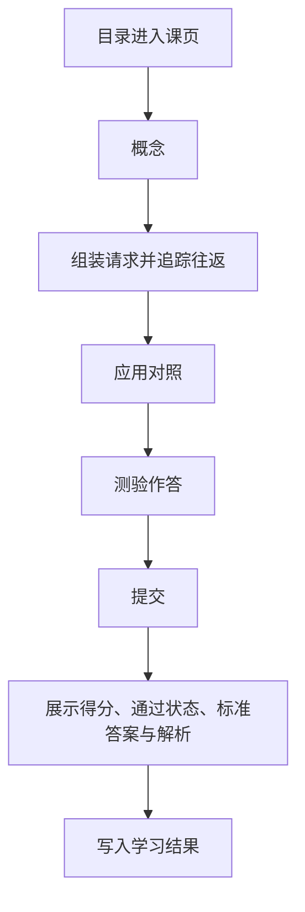

# HTTP 交互式学习（第一批）

## 1. 业务目标

目标用户是自学 HTTP 的人：能读文字，但还没把「一次请求由什么组成、在真实调用里长什么样」对上。本期在 `Izelzzz/interactive-tech-learning` 交付一门 HTTP 课中的 **1 个完整课页**，用一页交互教学验证学习效果。

交互气质对齐参考课页：先给可操作的演示，再在旁边说明，并用对照表和要点卡片把概念落到同一次调用。参考页：<https://study3.aipm.club/wot7WUbXykA7c19NkRDhC/aipm3_1wbTNJQWJrb2szZU8wT2RVZ/05%E6%99%BA%E8%83%BD%E4%BD%93/04Agent%E4%BA%A4%E4%BA%92/sources/index.html>

成功状态（可观察）：

1. 学习者从 HTTP 课程目录进入已发布课页「一次 HTTP 请求」，沿四个区块读完：概念 → 交互/可视化 → 应用 → 测验。
2. 学习者能组装样例请求、追踪一次往返，并在浏览器记录和 curl 里指出方法、目标与 Host。
3. 学习者提交课末测验后，看到每题标准答案、解析、得分，以及是否通过。
4. 平台可按课标识读取学习结果：课标识、测验是否完成、得分、是否通过。

**已确认**

- 一门课先行：HTTP。课内容由编者写成固定内容后发布；课页渲染的是这份已发布内容。
- 一课一页。页内顺序为概念、交互/可视化、应用、测验。
- 课页使用一套专业、可核对的中文。术语在第一次出现时用一句话说明它是什么。
- 可视化在有助于理解处出现。界面使用 shadcn/ui。请求报文、curl 与终端样例使用带标题和复制的 Code Block。
- 组装请求、往返追踪和字段标出由脚本按时间推进，操作后立刻换上这一步的说明。
- 课末测验含单选题与简答题。提交后在原处展示标准答案、解析、得分与是否通过。
- 第一批交付 1 个完整课页，先验证这一页的教学效果。
- 课页主体是页眉与教学区块。可视化、操作与测验都落在对应区块里。
- 学习结果至少包含：课标识、测验是否完成、得分、是否通过。作答与简答命中要点随结果保留，返回课页时填回作答区并展示命中要点。

**假设**

- 一页里的报文、可操作演示、真实对照和带答案测验，足以观察学习者是否建立可用理解。
- 得分与是否通过，能把「交过卷」和「达到通过线」分开。

## 2. 业务结构

### 2.1 角色与场景

| 角色 | 职责 |
|------|------|
| 学习者 | 从目录进入课页，阅读四区块，操作演示，提交测验并查看答案与得分 |
| 课程编者 | 编写并发布固定课：讲解、演示数据、应用示例、测验题、标准答案、解析与得分要点 |

场景：学习者打开 HTTP 课程目录，进入「一次 HTTP 请求」，在同一页完成学习与测验。

### 2.2 本期范围

- 一门已发布课程：HTTP。
- 第一批 1 个已发布课页。
- 课程目录列出该课并进入课页。
- 课页四区块按第 2.3 节的顺序排好。
- 一套讲解与解析。术语在第一次出现时用一句话说明。
- 两处可操作演示：按字段组装请求、按时间追踪一次往返。
- 应用区块用同一条样例对照浏览器请求与 curl，点字段后两边同时标出。
- 测验：2 道单选 + 1 道简答，提交后给答案、解析、得分与是否通过。
- 学习结果按第 1 节第 4 点保存，并保留作答与简答命中要点。

### 2.3 信息架构

```text
站点
├── 课程目录（HTTP）
└── 课页（一课一页）
    ├── 页眉：返回目录 | 课名 | 四区块入口
    ├── 概念
    ├── 交互 / 可视化
    ├── 应用
    └── 测验
```

页面对象：

| 对象 | 说明 |
|------|------|
| 课程 | 课的归属。第一批为 HTTP，课程标识 `http` |
| 课 | 一个可发布的教学单元。第一批课标识 `http-one-request`，课名「一次 HTTP 请求」 |
| 课页 | 这一课的唯一页面，含四个有序区块 |
| 讲解 | 全课一套。结构、题干、选项、演示与解析使用同一套中文 |
| 可视化 | 区块内可操作的演示，绑定本课样例数据 |
| 测验 | 单选、简答、分值、通过线、标准答案、解析、简答要点 |
| 学习结果 | 课标识、测验是否完成、得分、是否通过；作答与命中要点随结果保留 |

### 2.4 界面结构（设计约束）

课页是一条纵向阅读流。学习者看到的主体是页眉和四个教学区块。版式为居中栏、白底卡片、细边框。请求、curl 与终端样例放在带标题和复制按钮的代码块里。

| 区域 | 内含 |
|------|------|
| 页眉 | 返回目录；课名；四个区块入口（概念、交互、应用、测验），点按后滚到该区块。页眉随内容增高，入口保持可点 |
| 开篇 | 课名与一句学习结果 |
| 概念 | 先给出样例报文，再用表对上四个部分，然后是三张要点卡片和一条进入下一节的提示 |
| 交互 / 可视化 | 组装请求与追踪往返。每处有播放操作，当前步骤的说明在演示旁边 |
| 应用 | 浏览器记录与 curl 并排，表格点选后两边同时标出字段 |
| 测验 | 整行选项与简答；提交后的得分、是否通过、每题标准答案与解析 |

学习结果一句写在课名下：学完能说明一次请求由什么组成，并能在样例调用里指出方法、目标与 Host。

窄屏下四个区块仍按该顺序纵向排列。页眉入口换行后仍可点。应用对照改为上下排列。演示留在所在区块的宽度内，可读、可操作。

### 2.5 主流程



四个区块在同一页同时排好。学习者可以滚动阅读，也可以从页眉进入任一区块。演示可以逐步查看；查看进度与能否提交测验相互独立。提交后可以修改答案并再次提交，得分与是否通过以最近一次提交为准。

### 2.6 讲解

全课一套中文。方法、头、DNS、TCP、TLS、状态码在第一次出现时，用一句话说明它是什么。

| 维度 | 这一套讲解 |
|------|------------|
| 讲解 | 使用方法、目标、头、正文、Host 等术语，并在首次出现时说明 |
| 解析 | 用同一套术语指出字段归属 |
| 题干、选项、演示、区块顺序 | 全课共用这一套 |

### 2.7 第一课内容合同

全课贯穿同一条样例：

- 调用：`GET https://example.com/docs`
- 报文可见：方法 `GET`，目标定位 `example.com` 上的 `/docs`，头 `Host: example.com`
- 这条 GET 可以没有正文

概念区块先展示这条报文，再用表写清四件事：

1. 方法：这次要做什么。打开该页面这一次，方法是 GET。方法是请求行开头的动词。
2. 目标：要的资源在哪。样例要能定位主机 `example.com` 与路径 `/docs`。
3. 头：还要附带什么说明。头是「名字: 值」。样例带 `Host: example.com`。
4. 正文：要不要带一段数据。样例这条 GET 可以没有正文。

概念区块用要点卡片把路程放回请求旁边：DNS 解析地址，TCP 建立连接，TLS 为 HTTPS 加密。这三步在路上，不占方法、目标、头、正文的位置。状态码写在响应的状态行里。

交互 / 可视化区块两处，都可操作，并各有读图说明：

1. 组装请求：点「组装请求」后，报文按时间逐字段写上。写到方法、目标、头、正文的哪一段，旁边就换成这一段回答的问题和样例片段。点字段名会把标出条移到那一段。
2. 追踪往返：点「追踪往返」后，报文包按时间从客户端移到通路，再移到服务端。三步依次是客户端组成请求、请求在路上、服务端返回响应。每到一站，报文区换成这一站才出现的内容。点某一站会立刻换上这一站的说明，报文包同时移过去。通路上出现 DNS、TCP、TLS，请求字段保持原样。响应步出现状态行 `HTTP/1.1 200 OK`。

两处都用 shadcn/ui 呈现。报文、通路注释和响应状态行放在 Code Block 中。

应用区块并排展示这段样例的两份记录，并标出方法、目标、Host：

- 浏览器里的一次请求记录（请求行 `GET /docs HTTP/1.1` 与 `Host: example.com`）
- 等价命令：`curl https://example.com/docs`，以及它发出的同一条请求

点表格中的一行，两边同时标出该字段，并立刻显示这一行的说明。curl 未写方法时，默认方法是 GET。

测验在应用区块之后。选项是整行按钮。选择后立刻显示已选哪一项；提交后在原处展示标准答案与解析，并把选对的项和选错的项区分开。总分 100。通过线 60 分，达到 60 分即为通过。未作答的题按 0 分计，同时展示该题答案与解析。单选选项等长，两题的正确项分别落在不同位置。

**单选 1（25 分）**

题干：在一次 HTTP 请求里，表示「这次要做的动作」的部分是哪一个？

- A. 响应里带回的状态码
- B. 请求里标明的方法名
- C. 请求附带的那段正文
- D. 路上查找地址的步骤

标准答案：B

解析：方法标明这次要做的动作，样例是 GET。状态码在响应里。正文是附带数据，这条 GET 可以没有。DNS 在路上查地址，不是请求里的动作字段。

**单选 2（25 分）**

题干：样例「打开 https://example.com/docs」里，方法和目标怎样对应？

- A. 方法为TLS，目标交给DNS
- B. 方法Host，目标写成GET
- C. 方法GET，目标是/docs
- D. 方法POST，目标写成网站根

标准答案：C

解析：打开这个 URL，方法是 GET，目标要能定位路径 /docs。Host 是头，不是方法。TLS 与 DNS 发生在路上。

**简答（50 分）**

题干：用自己的话写出一条最小 HTTP 请求要交代的三件事。每件事给一个名称，并举一个来自本课样例的例子。样例没有正文时，第三件说明可以没有正文，并举出一个仍然会出现的头。

参考答案：

1. 动作：方法，样例是 GET。
2. 目标：哪个资源，样例是 `https://example.com/docs`（或路径 `/docs` 加上主机 `example.com`）。
3. 附带信息：头或正文。样例 GET 可以没有正文，仍然带有 `Host: example.com`。

简答按要点做包含匹配，大小写不敏感，一个要点只计一次。提交文本命中该要点任一可接受表述，即获得该要点分数。

| 要点 | 分值 | 可接受表述 |
|------|------|------------|
| 动作 | 16 | 方法、GET、动作、要做什么、动词 |
| 目标 | 17 | URL、/docs、example.com、路径、目标、资源、地址、主机 |
| 附带信息 | 17 | Host、头、Header、首部、正文、body、附带、可以没有正文、没有正文 |

课页在提交后展示参考答案全文、命中了哪些要点、得分与是否通过。

课页在测验之后给出 MDN《HTTP 概述》链接，并写明读完仍有疑问可以直接问。

## 3. 用户故事

1. 作为初学 HTTP 的人，我希望在一页里先看到样例报文，再读方法、目标、头和正文，以便能复述一次请求由什么组成。
2. 作为学习者，我希望术语在第一次出现时用一句话说明，以便不用另找一套说法对照。
3. 作为学习者，我希望组装报文、追踪一次往返，以便看见字段怎样写上、状态码出现在哪一步。
4. 作为学习者，我希望看到这条样例在浏览器记录和 curl 里的对应位置，以便知道概念用在哪。
5. 作为学习者，我希望做单选和简答，提交后看到答案、解析、得分和是否通过，以便核对学会了没有。
6. 作为课程编者，我希望用固定内容配置四区块和测验答案，以便这一课可以重复发布。

## 4. 功能清单

| 能力 | 业务规则 | 故事 |
|------|----------|------|
| 目录进入 | 目录列出已发布的 HTTP 课。第一批进入「一次 HTTP 请求」课页 | 1–6 |
| 四区块课页 | 同一页按概念、交互/可视化、应用、测验排列。页眉入口滚到对应区块 | 1、3、4、5 |
| 一套讲解 | 讲解与解析使用同一套中文。术语第一次出现时用一句话说明 | 1、2 |
| 可视化 | 组装请求按时间写入字段；往返按时间移动报文包。点选后立刻显示该步说明。样例放在 Code Block 中 | 3 |
| 应用对照 | 展示第 2.7 节样例的浏览器记录与 curl，点字段后两边同时标出方法、目标、Host | 4 |
| 测验提交 | 两道单选与一道简答按第 2.7 节计分。提交后展示标准答案、解析、得分、是否通过。再次提交覆盖得分与是否通过 | 5 |
| 结果记录 | 保存课标识、测验是否完成、得分、是否通过，并保留作答与命中要点。有过一次提交后，测验完成为是 | 5、6 |

## 5. 边界与异常

| 情形 | 业务预期 |
|------|----------|
| 课已发布 | 目录出现「一次 HTTP 请求」，进入第 2.7 节的课页 |
| 课未发布 | 目录只列出已发布课 |
| 测验尚未提交 | 四个区块都可阅读；该课测验完成为否 |
| 某题未作答就提交 | 该题记 0 分，并展示标准答案与解析；已作答的题照常计分 |
| 简答未命中任何要点 | 简答记 0 分，并展示参考答案与解析 |
| 得分低于 60 | 测验完成为是，是否通过为否，展示实际得分 |
| 得分达到或超过 60 | 是否通过为是 |
| 首次打开 | 组装停在可播放的报文预览，往返停在客户端组成请求，测验尚未提交 |
| 离开后返回 | 已有提交则展示最近一次得分、通过状态、答案与解析，作答区填回该次答案 |
| 窄屏 | 四区块纵向排列；页眉入口换行后仍可点；应用的两份记录上下排列；演示在区块内可读、可操作 |

## 6. 验收标准

1. 学习者可从 HTTP 目录进入已发布课「一次 HTTP 请求」，同一页按顺序包含概念、交互/可视化、应用、测验，且样例 `GET https://example.com/docs` 贯穿这三块教学内容。（故事 1、3、4）
2. 组装请求可按时间写入方法、目标、头、正文，点选后立刻显示对应说明。往返可按时间查看客户端组成请求、请求在路上、服务端返回响应。两处都有读图说明。样例出现在带复制的代码块中。（故事 3）
3. 课页讲解与解析是一套。方法、头、DNS、TCP、TLS、状态码在课页中第一次出现时有一句说明。（故事 1、2）
4. 提交测验后可见第 2.7 节三题的标准答案与解析、满分 100 的得分，以及是否达到 60 分通过线。未作答题按 0 分计。简答按该节要点与可接受表述计分。（故事 5）
5. 提交后可读取课标识 `http-one-request`、测验已完成、得分、是否通过。再次提交后，得分与是否通过为最近一次。作答与命中要点随结果保留。（故事 5、6）
6. 课页主体为页眉加四个教学区块；可视化与测验出现在各自区块内。（设计约束）
7. 第 5 节各情形的业务预期，即为该情形的验收。

## 7. 术语表

| 术语 | 含义 | 在本期中 | 边界 |
|------|------|----------|------|
| 课程 | 一组已发布的课 | HTTP，标识 `http` | 第一批一门课 |
| 课页 | 一课对应的一张交互教学页 | 「一次 HTTP 请求」，标识 `http-one-request` | 第一批一页 |
| 概念区块 | 用第一性原理拆开本课概念 | 方法、目标、头、正文，以及它们为何存在 | 课页第一节 |
| 交互区块 | 用可操作演示把概念拆开 | 组装请求与一次往返 | 紧随概念 |
| 应用区块 | 把同一概念对上真实调用 | 浏览器记录与 curl 对照 | 紧随交互 |
| 测验 | 课末单选与简答 | 提交后给答案、解析、得分、是否通过 | 紧随应用 |
| 讲解 | 全课一套中文 | 术语首次出现时用一句话说明 | 题干与演示共用这一套 |
| 学习结果 | 一课的测验记录 | 课标识、是否完成、得分、是否通过 | 以最近一次提交为准 |
| 通过 | 得分达到该课通过线 | 第一课 60 分 | 与得分同时可读 |

## 8. 决策日志

| 时间 | 变更点 | 理由 | 决策人 |
|------|--------|------|--------|
| 2026-10-17 | 固定课、双版本、HTTP 先行；两套讲解分开维护 | 验证交互相对纯文是否更有效 | Izel |
| 2026-10-18 | 采用「请求当主角」+ 组包即测验 + 同屏模式切换 | 隐喻清晰、练习像真干活 | Izel |
| 2026-10-18 | UI 一屏主块 ≤2：舞台为主，组包步才出组包条；顶栏保留小白/专业 | 降复杂度，保留深度切换 | Izel |
| 2026-10-18 | 规格补信息架构与界面结构，供工程实现对照 | 工程可读、设计可验收 | Izel / 福尔摩斯 |
| 2026-10-17 | 仓库 `Izelzzz/interactive-tech-learning` | 独立承载本产品 | Izel |
| 2026-10-18 | 第一批交付 1 个完整单元路径 | 先以一条完整单元路径验证学习效果 | Izel |
| 2026-10-18 | 故障路径某一坑可跳过 | 跳过记为已跳过并进入下一步，路径仍可走到结束回放 | Izel |
| 2026-10-18 | 放弃「请求当主角」舞台、组包条、故障路径（含跳过）作为主信息架构，改为课程目录 → 课页 | 隐喻路径与一课一页的教学阅读冲突；效果改为读完教学区块并完成带答案的测验 | Izel / 福尔摩斯 |
| 2026-10-18 | 采用一课一页：概念 → 交互/可视化 → 应用 → 测验。可视化使用 shadcn/ui 等开源组件。测验为单选加简答，提交后给出标准答案与解析 | 对齐参考课页：拆开概念，从第一性原理讲到实践，并落回真实应用 | Izel / 福尔摩斯 |
| 2026-10-18 | 小白/专业保留为同一课页的文案深度；区块、可视化与题干一套 | 只替换讲解句与解析，课页保持一条教学流 | Izel / 福尔摩斯 |
| 2026-10-18 | 第一批仍为 1 个完整课页「一次 HTTP 请求」。学习结果含课标识、测验是否完成、得分、是否通过 | 先用一页验证教学效果 | Izel / 福尔摩斯 |
| 2026-10-19 | 课页使用一套专业中文。术语在第一次出现时用一句话说明。单选选项等长，标准答案分别是 B 与 C。学习结果记录课标识、测验是否完成、得分、是否通过，并保留作答与命中要点。请求、curl 与终端样例使用 shadcn Code Block。组装、往返和字段标出由脚本按时间推进 | 课页要达到参考课的清晰度、完成度和有目的的交互 | Izel |
