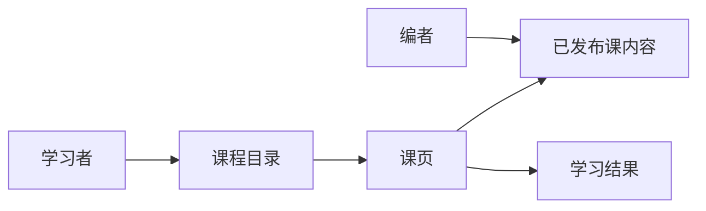
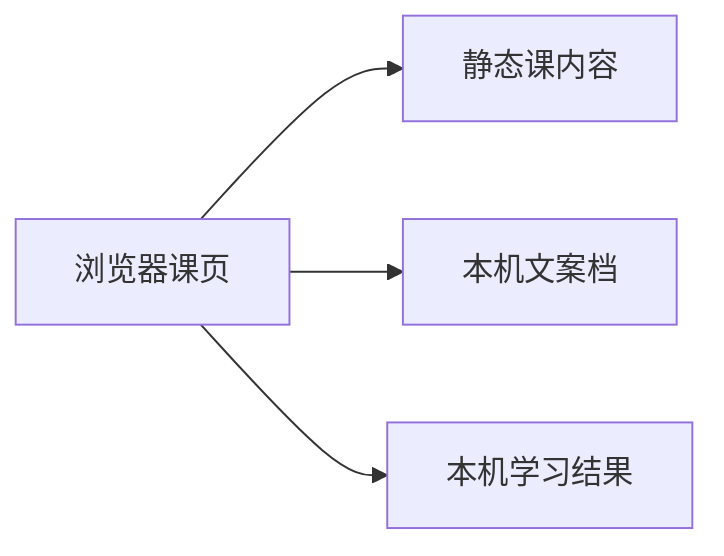

# HTTP 交互式学习（第一批）技术规格

依据产品规格：`docs/2026-10-18-http-course-from-scratch/产品规格.md`

## 1. 技术目标与范围

| 产品合同 | 技术上须保证 | 不在本期 |
|----------|--------------|----------|
| 验收 1 | 目录列出已发布课并进入课页。课页按概念、交互/可视化、应用、测验排列。样例 `GET https://example.com/docs` 出现在概念、可视化与应用三块。见接口表「列出已发布课」「加载课页」与字段表 `sample` | 本期交付课程 `http` 的目录，以及已发布课 `http-one-request`「一次 HTTP 请求」这一页 |
| 验收 2 | 交互区块内，报文的方法、目标、头、正文可点选，并显示该部分解决什么、样例对应哪一段。往返可逐步查看「客户端组成请求 → 请求报文到达服务端 → 服务端返回响应」。两处各有一句读图说明。见字段表 `messageParts`、`roundTrip` | 本期交付这两处可操作图示 |
| 验收 3 | `copyDepth` 为 `beginner`（小白）或 `pro`（专业）。切换后讲解句与测验解析改为该档；题干、选项、可视化结构与已填答案保持。见接口表「写入文案档」与字段表 `copy` | 本期交付同一课页上的两档文案 |
| 验收 4 | 两道单选各 25 分，简答 50 分，满分 100，达到 60 分为通过。未作答题记 0 分并展示该题标准答案与解析。简答按字段表要点做包含匹配。提交后展示三题标准答案、解析、得分与是否通过。见接口表「提交测验」 | 本期交付产品第 2.7 节这三题 |
| 验收 5 | 提交后可按 `lessonId` 读到 `quizCompleted: true`、`score`、`passed`、提交时的 `copyDepth`。再次提交覆盖 `score`、`passed` 与提交时的 `copyDepth`。见接口表「读取学习结果」「提交测验」与字段表学习结果 | 本期交付浏览器本机上的这份学习结果 |
| 验收 6 | 课页先渲染页眉，再按顺序渲染四个教学区块。报文与往返出现在交互区块内，测验出现在测验区块内 | 本期交付这一条纵向课页 |
| 验收 7 / 第 5 节边界 | 状态与错误表逐行覆盖已发布、未发布、尚未提交、未作答、简答未命中、低于 60、达到 60、切换文案档、首次打开、离开后返回、窄屏 | 本期按该表交付这些情形的可观察结果 |

## 2. 业务架构图

能力落在课程目录、课页、已发布课内容与学习结果四块，故附图。课页内按顺序包含概念、交互/可视化、应用、测验；文案档在课页内替换讲解与解析。



## 3. 技术架构图

课页在浏览器内读取静态课内容、完成本地计分，并写入本机记录，故附图。本机记录分成文案档与学习结果两条数据。



## 4. 接口与数据契约

本期课页与课内容同仓交付。接口指内容加载、文案档与学习结果的读写契约。错误体形态为 `{ "error": { "code", "message" } }`，用于课标识无法打开已发布课页时。

### 接口

| 操作 | 方法与路径 | 成功 | 失败见 | 产品合同 |
|------|------------|------|--------|----------|
| 列出已发布课 | 读课程内容中 `published: true` 的课 | 课摘要：`courseId`、`lessonId`、`title` | 错误表「课未发布」 | 验收 1；边界：课已发布、课未发布 |
| 加载课页 | 读 `lessonId` 对应且已发布的课内容 | 页眉、四区块、双档文案、可视化数据、应用记录、测验 | 错误表「课标识无法对应已发布课」 | 验收 1、2、6 |
| 读取文案档 | 读本机该课文案档 | `beginner` 或 `pro` | 无记录时为 `beginner` | 边界：首次打开、离开后返回 |
| 写入文案档 | 写本机该课文案档 | 更新 `copyDepth`，已填答案保持 | — | 验收 3；边界：切换文案档 |
| 提交测验 | 按字段表计分并写本机学习结果 | `score`、`passed`、标准答案、解析、简答命中要点 | 错误表「未作答」「简答未命中」 | 验收 4、5 |
| 读取学习结果 | 读本机该课学习结果 | 有提交时五项齐全；无提交时 `quizCompleted: false` | — | 验收 5；边界：尚未提交、离开后返回 |

### 字段与枚举

| 名称 | 含义 | 约束 |
|------|------|------|
| `courseId` | 课程 | 本期为 `http` |
| `lessonId` | 课 | 本期已发布课为 `http-one-request` |
| `published` | 是否进入目录 | 仅为 `true` 时出现在目录，并可打开课页 |
| `title` | 课名 | 「一次 HTTP 请求」 |
| `outcome` | 页眉学习结果一句 | 学完能说明一次请求由什么组成，并能在样例调用里指出方法、目标与 Host |
| `copyDepth` | 文案档 | 仅 `beginner`（小白）、`pro`（专业） |
| `sample.method` | 样例方法 | `GET` |
| `sample.url` | 样例调用 | `https://example.com/docs` |
| `sample.host` | 样例主机 | `example.com` |
| `sample.path` | 样例路径 | `/docs` |
| `sample.hostHeader` | 样例头 | `Host: example.com` |
| `sample.curl` | 等价命令 | `curl https://example.com/docs` |
| `sections` | 课页区块顺序 | `concept`、`interactive`、`application`、`quiz` |
| `copy.beginner` / `copy.pro` | 讲解句与解析 | 概念讲解、读图说明、部分说明、往返步骤说明、应用说明、三题解析各写两档。题干、选项、可视化结构、样例字段共用 |
| `messageParts` | 报文可点选部分 | 仅 `method`、`target`、`header`、`body`。点选后显示该部分解决什么，以及样例中的对应片段：方法 `GET`；目标定位 `example.com` 与 `/docs`；头 `Host: example.com`；正文说明这条 GET 可以没有正文 |
| `roundTrip` | 一次往返 | 顺序为 `compose`（客户端组成请求）、`arrive`（请求报文到达服务端）、`respond`（服务端返回响应）。学习者可逐步查看 |
| `browserRecord` | 浏览器请求记录 | 请求行 `GET /docs HTTP/1.1` 与头 `Host: example.com`。标出方法 `GET`、目标 `/docs`、Host `example.com` |
| `curlRecord` | curl 记录 | 命令为 `sample.curl`。目标标在 `https://example.com/docs`，Host 标在 `example.com`，方法以标注 `GET` 呈现在该记录上 |
| `quiz.questions` | 测验题 | 顺序为两道 `single` 与一道 `short`，题干与选项使用产品第 2.7 节原文 |
| `single.points` | 单选分值 | 每题 25。选项与标准答案一致时得 25，否则得 0。标准答案均为 A |
| `short.points` | 简答分值 | 50，由下列三个要点相加 |
| `rubric.action` | 简答要点「动作」 | 16 分。可接受表述：方法、GET、动作、要做什么、动词 |
| `rubric.target` | 简答要点「目标」 | 17 分。可接受表述：URL、/docs、example.com、路径、目标、资源、地址、主机 |
| `rubric.extra` | 简答要点「附带信息」 | 17 分。可接受表述：Host、头、Header、首部、正文、body、附带、可以没有正文、没有正文 |
| 简答匹配 | 包含匹配 | 大小写不敏感的子串匹配。一个要点只计一次。提交文本命中该要点任一可接受表述，即获得该要点分数 |
| `passScore` | 通过线 | 60。`score >= 60` 时 `passed` 为 true |
| `quizCompleted` | 测验是否完成 | 有过一次提交后为 true |
| `score` | 得分 | 整数 0–100。有提交后出现 |
| `passed` | 是否通过 | 有提交后出现，由 `score` 与 `passScore` 决定 |
| `answers` | 最近一次提交的作答 | 随学习结果保留，用于返回课页时展示命中要点并填回作答区。平台读取学习结果时，对外字段仍是 `lessonId`、`quizCompleted`、`score`、`passed`、`copyDepth` |
| `hits` | 简答命中的要点 | 提交后由匹配结果得出，取值为 `action`、`target`、`extra` 的子集 |

### 状态与错误

| 情形 | HTTP | error.code | 对外说明 | 是否创建或沿用 |
|------|------|------------|----------|----------------|
| 课已发布 | — | — | 目录出现「一次 HTTP 请求」，打开第 2.7 节课页 | 进入课页 |
| 课未发布 | — | `lesson_unpublished` | 目录只列出已发布课 | 留在目录 |
| 课标识无法对应已发布课 | — | `lesson_unavailable` | 目录里没有这一课 | 留在目录，并给出返回目录 |
| 测验尚未提交 | — | — | 四个区块都可阅读 | 读取结果为 `quizCompleted: false`。`score` 与 `passed` 在有提交后出现 |
| 某题未作答就提交 | — | — | 该题记 0 分，并展示标准答案与解析 | 写入学习结果；已作答题照常计分 |
| 简答未命中任何要点 | — | — | 简答记 0 分，展示参考答案、解析，命中要点为空 | 写入学习结果 |
| 得分低于 60 | — | — | 展示实际得分，是否通过为否 | `quizCompleted: true`，`passed: false` |
| 得分达到或超过 60 | — | — | 展示实际得分，是否通过为是 | `quizCompleted: true`，`passed: true` |
| 切换文案档 | — | — | 讲解与解析改为所选档 | 沿用已填答案与当前可视化选择 |
| 首次打开 | — | — | 文案档为小白 | `copyDepth: beginner` |
| 离开后返回 | — | — | 文案档恢复为上次所选。已有提交则展示最近一次得分、通过状态、标准答案、解析与命中要点 | 沿用本机文案档与最近一次学习结果，作答区填回该次答案 |
| 窄屏 | — | — | 四区块仍按概念、交互、应用、测验纵向排列 | 两处可视化留在交互区块宽度内，可读、可操作；应用的两份记录改为上下排列 |

### 事件

提交后的得分、通过状态、标准答案、解析与命中要点在同一课页返回，并写入本机学习结果。本期契约以页内同步结果为准。

## 5. 模块边界与实现决策

- 模块：已发布课内容（固定数据：四区块、双档讲解与解析、可视化样例、应用记录、测验与要点）；目录（呈现 `published: true` 的课）；课页（页眉、四区块、文案档、可视化操作、测验作答）；计分（按字段表计算 `score`、`passed` 与 `hits`）；本机记录（读写文案档与学习结果）。内容只被读取。计分的结果由课页写入本机记录。
- 契约取舍：产品「小白 / 专业」对应 `beginner` / `pro`，只替换 `copy` 中的讲解与解析。产品「通过线 60」对应 `passScore`。产品「简答按要点包含匹配」对应字段表 `rubric` 与匹配规则。产品「学习结果可按课标识读取」对应本机记录中的 `lessonId`、`quizCompleted`、`score`、`passed`、提交时的 `copyDepth`。`answers` 随结果保留，使返回后仍能展示命中要点并修改后再交；平台读取时对外仍是上述五项。curl 记录的方法以标注 `GET` 出现在命令旁，命令文本保持 `curl https://example.com/docs`。可视化用开源切换组件承载点选与逐步查看，图示按 `messageParts` 与 `roundTrip` 拼装。
- 状态与交互：

```text
目录 --published--> 课页
首次打开：copyDepth = beginner，quizCompleted = false
切换文案档：更新 copyDepth，answers 保持
报文点选与往返步骤：只改变可视化位置
提交：计分，quizCompleted = true，写入 score、passed、当时的 copyDepth、answers、hits
再次提交：覆盖 score、passed、copyDepth、answers、hits
返回：恢复 copyDepth；已提交则展示该次结果并填回 answers
```

打开课页时，报文先呈现「方法」，往返先呈现「客户端组成请求」。学习者可改选其他部分、逐步查看其余步骤。可视化位置与能否提交相互独立。

窄屏宽度以 720px 为界：此宽度以下，应用区块的浏览器记录与 curl 上下排列；页眉入口仍滚到对应区块。

## 6. 测试决策与可核对检查项

### 测试决策

- 测什么：目录只含已发布课；课页四区块顺序与样例；两档讲解和解析不同而题干、选项相同；切换文案档后已填答案保持；单选与简答计分、通过线、未作答与未命中；学习结果五项可读写，再次提交覆盖得分与是否通过；返回后文案档与最近一次结果可恢复。
- 不测什么：自动检查核对目录、区块、文案、计分与学习结果字段。图示是否在区块宽度内可读、可操作，由打开课页人工对照。
- 模块：计分、内容加载、文案档切换、本机记录、课页结构。
- 可对照的既有测试：本仓库此前无课页行为测试。本检查项是第一批行为契约。

### 可核对检查项

1. 验收 1：已发布课可从 HTTP 目录进入 `http-one-request`。同一页顺序为概念、交互/可视化、应用、测验。样例 `GET https://example.com/docs` 出现在这三块教学内容中。
2. 验收 2：报文可点选方法、目标、头、正文，并显示对应说明与样例片段。往返可逐步查看三步。两处都有读图说明。
3. 验收 3：切换小白 / 专业后，当前讲解句与测验解析改为该档；题干、选项、可视化结构与已填答案保持。
4. 验收 4：提交后可见第 2.7 节三题的标准答案与解析、满分 100 的得分，以及是否达到 60 分。未作答题为 0 分。简答按字段表要点计分，并展示命中要点。
5. 验收 5：提交后可读 `lessonId` 为 `http-one-request`、`quizCompleted` 为 true、`score`、`passed`、提交时的 `copyDepth`。再次提交后 `score` 与 `passed` 为最近一次。
6. 验收 6：课页主体为页眉加四个教学区块。可视化在交互区块内，测验在测验区块内。
7. 第 5 节各情形的状态与对外说明以状态与错误表为准。
8. 打开本仓库的课程目录与课页 `http-one-request` 核对上述表面。

## 7. 未决、风险与依赖

| 类别 | 项 | 已掌握 | 待决、风险或依赖 | 责任人 | 期限 |
|------|----|--------|------------------|--------|------|
| 风险 | 本机记录被清除 | 验收 5 按课标识读取最近一次提交 | 清除站点数据后，该课回到尚未提交。对照学习效果时以当时仍保留的本机记录为准 | 产品 + 工程 | 样板课验收时 |
| 风险 | 双档文案与课结构脱节 | 验收 3 要求切换后讲解与解析改为所选档 | 讲解与解析放在已发布课内容中，由内容加载测试核对两档解析不同、题干相同 | 工程 | 本课页交付时 |
| 依赖 | 产品规格 | 本文件依据 `docs/2026-10-18-http-course-from-scratch/产品规格.md` | 用户可见结果的变更先改产品规格，再改本技术规格 | 福尔摩斯 / Izel | 随产品变更 |
| 依赖 | 开源界面组件 | 产品允许 shadcn/ui 及同类组件呈现图示 | 报文点选、往返步骤与文案档切换使用 Radix 切换组件，图示按课内容拼装 | 海藻头 | 本课页交付时 |

## 8. 技术决策日志

| 时间 | 实现取舍 | 相对哪条产品决策 | 决策人 |
|------|----------|------------------|--------|
| 2026-10-18 | 技术规格按一课一页重写：课程目录进入课页，页内为概念、交互/可视化、应用、测验 | 产品决策日志 2026-10-18：主信息架构改为课程目录 → 课页 | 海藻头 |
| 2026-10-18 | 浏览器单页应用读取静态课内容，计分在页内完成，学习结果写入本机记录 | 验收 5「可按课标识读取学习结果」。本机记录保持五项字段的含义 | 海藻头 |
| 2026-10-18 | 文案档取值 `beginner` / `pro`。讲解与解析按档取自课内容，题干、选项与可视化结构共用 | 产品 2.6 文案档；验收 3 | 海藻头 |
| 2026-10-18 | 简答按要点做大小写不敏感的子串包含匹配，一个要点只计一次，分值 16 / 17 / 17 | 产品 2.7 简答计分；验收 4 | 海藻头 |
| 2026-10-18 | 最近一次作答随学习结果保留，返回课页时展示命中要点并填回作答区。对外读取字段仍是课标识、是否完成、得分、是否通过、提交时的文案档 | 边界「离开后返回」；产品 2.7「展示命中了哪些要点」 | 海藻头 |
| 2026-10-18 | 报文点选与往返逐步查看使用 Radix 切换组件，图示由课内容数据拼装 | 产品「可视化使用开源界面与图示组件，允许 shadcn/ui 及同类库」 | 海藻头 |
