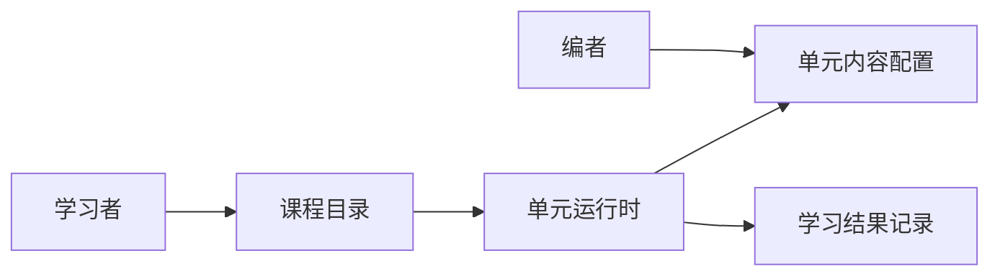
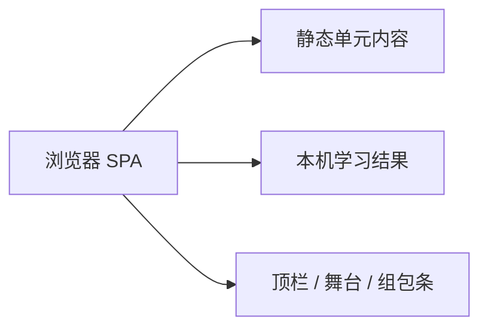

# HTTP 交互式学习（第一批）技术规格

依据产品规格：`docs/2026-10-18-http-course-from-scratch/产品规格.md`（PR #1 / 分支 `feature/grokbot/http-interactive-product-spec`）

## 1. 技术目标与范围

| 产品合同 | 技术上须保证 | 本期边界（已交付为止） |
|----------|--------------|------------------------|
| 验收 1：目录进入 + 小白或专业走完正常五步（含一次成功组包） | 已发布单元可列入目录；单元页可切换模式；正常路径步骤顺序 DNS→TCP→TLS→组包→响应；组包校验通过后进入响应 | 本期交付固定课壳与内容驱动；学习结果存浏览器本机 |
| 验收 2：模式切换改文案与失败提示，步骤进度保留 | 模式为运行时状态；文案与失败提示按模式解析；进度键与模式解耦 | 同单元同路径进度跨模式保留 |
| 验收 3：非法组包不可进响应；修正后可进 | 组包校验纯前端按规则判定；失败保留已填字段并显示一行原因 | 组包字段以该步规则为准 |
| 验收 4：故障路径至少一种可修复失败，修复后可至结束回放 | 故障路径步骤可带失败态与修复成功条件；修复成功后前进 | 故障关卡由内容配置驱动 |
| 验收 5：完课后可读取单元、模式、路径类型、完课、组包是否一次成功 | 完课写入学习结果记录；对外可读字段见字段表 | 本期结果存储为浏览器本机；无账号同步 |
| 验收 6：非组包步主视野=顶栏+舞台；组包步=顶栏+舞台+组包条 | UI 壳按步骤类型显隐组包条；进度条与路径大开关默认不进主视野 | 一屏主块约束由壳保证 |
| 验收 7 / 第 5 节边界 | 错误与边界表覆盖未发布单元、组包失败、故障未修复、模式切换、中断恢复、小屏布局 | 见状态与错误表 |
| 产品边界：固定课、双深度同壳、请求当主角、组包即测验 | 内容为版本化单元数据；壳与内容分离；单请求路径 | 内容编写工具为仓库内数据文件编辑 |

## 2. 业务架构图

能力落在课程目录、单元运行时、内容配置与学习结果四块，故附图。



## 3. 技术架构图

本期为单页应用 + 静态内容 + 浏览器本机存储；无服务端 API。系统边界：浏览器内壳读取发布内容并写入本机进度。



## 4. 接口与数据契约

本期壳与内容同仓交付；「接口」指内容加载与本机结果读写契约（无 HTTP API）。

### 接口

| 操作 | 方法与路径 | 成功 | 失败见 | 产品合同 |
|------|------------|------|--------|----------|
| 列出已发布单元 | 读内容清单 `published=true` | 单元摘要列表 | 错误表「无已发布单元」 | 验收 1；目录 |
| 加载单元 | 读单元内容包 | 正常/故障路径步骤、双模文案、组包规则 | 错误表「单元不可用」 | 验收 1–4 |
| 读取进度 | 读本机键 `unitId` | 上次步骤索引、模式、路径类型 | 无记录则默认小白 + 正常路径第 0 步 | 边界：中断返回 |
| 写入进度 | 写本机键 | 更新步骤、模式、路径 | — | 验收 2、7 |
| 写入完课结果 | 写本机结果 | 见字段表五项 | — | 验收 5 |
| 读取完课结果 | 读本机结果 | 五项齐全或空 | — | 验收 5 |

错误体形态（壳内）：`{ "error": { "code", "message" } }`（组包失败提示对学习者展示 `message`，按模式取文案）。

### 字段与枚举

| 名称 | 含义 | 约束 |
|------|------|------|
| `courseId` | 课程 | 本期固定 `http` |
| `unitId` | 单元 | 稳定字符串；目录与结果共用 |
| `published` | 是否进目录 | 仅 `true` 出现在目录 |
| `mode` | 讲解深度 | 仅 `beginner`（小白）、`pro`（专业） |
| `pathType` | 路径类型 | 仅 `normal`、`fault` |
| `stepId` | 步骤 | 单元内唯一 |
| `stepType` | 步骤类型 | 仅 `advance`（讲解推进）、`pack`（组包）、`repair`（故障修复） |
| `copy.beginner` / `copy.pro` | 当前步主文案 | 必填字符串 |
| `failHint.beginner` / `failHint.pro` | 失败一行原因 | 组包/故障失败时按模式取 |
| `packRule.fields` | 组包必填字段 | 至少含 Method、Path、Host；可扩展同一步规定字段 |
| `packRule.validCombinations` | 合法组合 | 显式列表或等价规则；通过才进响应 |
| `packOnceSuccess` | 组包是否一次成功 | 布尔；首次发送即通过为 true |
| `completed` | 是否完课 | 走到结束回放且满足该路径规则为 true |
| `progress.stepIndex` | 当前步 | 非负整数；模式切换时保留 |
| 舞台主操作 | `next` / `retry` | 非组包失败用 next；失败态用 retry |
| 组包主操作 | `send` | 触发校验 |

### 状态与错误

| 情形 | HTTP | error.code | 对外说明 | 是否创建或沿用 |
|------|------|------------|----------|----------------|
| 目录无已发布单元 | — | `no_published_units` | 暂无已发布单元 | 目录空态 |
| 单元未发布或缺失 | — | `unit_unavailable` | 该单元不可用 | 不进入单元页 |
| 组包缺必填或非法组合 | — | `pack_invalid` | 按模式取 `failHint` | 留在组包步；保留已填项 |
| 故障步未满足修复条件 | — | `repair_incomplete` | 按模式取 `failHint` | 留在本步；可重试 |
| 本机存储不可用 | — | `storage_unavailable` | 进度无法保存，可继续本会话学习 | 会话内内存进度；完课结果尽力写入 |

### 事件

本期不产生跨端事件；状态仅在壳内同步更新（舞台、组包条、本机存储）。

## 5. 模块边界与实现决策

- 模块：`content`（单元 JSON/等价静态配置，含双模文案、组包规则、故障配置）；`catalog`（过滤 `published`）；`runtime`（路径推进、模式、校验、回放）；`ui-shell`（顶栏、舞台、组包条显隐，主块 ≤2）；`progress-store`（本机读写进度与完课结果）。内容模块只被读取；runtime 写入 store。
- 契约取舍：产品「固定课」对应内容进版本库、壳不生成整课。产品「同屏模式切换」对应仅替换文案与提示，`progress.stepIndex` 与 `pathType` 不变。产品「组包即测验」对应 `pack` 步校验通过才允许进入响应步。产品「学习结果可读取」对应本机结果五项字段；无服务端账号。
- 状态与交互：

```text
目录 → 单元(normal|fault) → 步骤序列 → 结束回放 → 写 completed
mode 可随时切换；不重置 stepIndex
pack: send → pack_invalid 则停留；通过则进入响应步
repair: 修复条件满足 → 下一步；否则 repair_incomplete
```

组包条仅 `stepType=pack` 时挂载。完整五步进度条与路径大开关默认不渲染进主视野；路径入口为弱入口（产品信息架构）。

## 6. 测试决策与可核对检查项

### 测试决策

- 测什么：目录只含已发布单元；五步顺序；模式切换后文案/失败提示变化且进度保留；非法组包不进响应；故障修复后可达回放；完课结果五项可读；非组包/组包步主块数量。
- 不测什么：动画帧、具体 CSS 像素、私有函数名、存储键字面量（只测读写后的可观察结果）。
- 模块：runtime 校验与推进；ui-shell 显隐；progress-store 读写后的对外字段。
- 可对照的既有测试：仓库初期可无；以本检查项为第一批行为契约。

### 可核对检查项

1. 验收 1：已发布单元可从目录进入；小白或专业下正常路径可走完 DNS→TCP→TLS→组包→响应，且组包至少一次成功。
2. 验收 2：切换模式后当前步文案与组包失败提示随模式变化，`progress.stepIndex` 不变。
3. 验收 3：非法组合触发 `pack_invalid` 语义（一行原因、保留已填）；合法后可进响应。
4. 验收 4：故障路径至少一步可失败并修复，之后可到结束回放。
5. 验收 5：完课后可读 `unitId`、`mode`、`pathType`、`completed`、`packOnceSuccess`。
6. 验收 6：非组包步仅顶栏+舞台；组包步另含组包条。
7. 第 5 节边界：以状态与错误表为准。

## 7. 未决、风险与依赖

| 类别 | 项 | 已掌握 | 待决、风险或依赖 | 责任人 | 期限 |
|------|----|--------|------------------|--------|------|
| 未决 | 第一批单元数量与标题 | 产品规格待 Izel 确认；建议 3～5 | 闭合前内容包可先落地 1 个样板单元数据结构；标题与数量以产品闭合为准，技术不替产品定课名 | Izel | 第一批单元清单敲定前 |
| 未决 | 故障路径是否允许跳过某一坑 | 产品规格待确认 | 闭合前故障步一律走修复成功条件前进；跳过开关不进入契约 | Izel | 同上 |
| 风险 | 内容与壳耦合 | 壳须内容驱动 | 若文案写死在组件，双模与组包规则无法复用，验收 2/3/4 难扩第二单元 | 工程 | 脚手架合并前 |
| 风险 | 本机存储被清 | 验收 5 依赖可读记录 | 清缓存后记录消失；对照学习效果时需约定统计窗口 | 产品+工程 | 样板课验收前 |
| 依赖 | 产品规格 PR #1 | 技术规格依据该文 | 产品合同变更须先改产品规格再改本技术规格 | 福尔摩斯 / Izel | 随 PR |

## 8. 技术决策日志

| 时间 | 实现取舍 | 相对哪条产品决策 | 决策人 |
|------|----------|------------------|--------|
| 2026-10-18 | 本期采用浏览器 SPA + 静态单元内容 + 本机学习结果；无服务端 API | 验收 5「可读取记录」+ 固定课先行；不改变「记录五项字段」的用户可见结果 | 海藻头 |
| 2026-10-18 | 内容与壳分离：单元数据携带双模文案、组包规则、故障配置 | 故事 5 编者配置；功能「固定课可复用同一壳」 | 海藻头 |
| 2026-10-18 | 模式枚举 `beginner`/`pro`；路径 `normal`/`fault`；步骤类型 `advance`/`pack`/`repair` | 信息架构与模式差异表 | 海藻头 |
| 2026-10-18 | 组包校验与故障修复判定在客户端按内容规则执行 | 组包即测验；故障可配置失败与修复 | 海藻头 |
