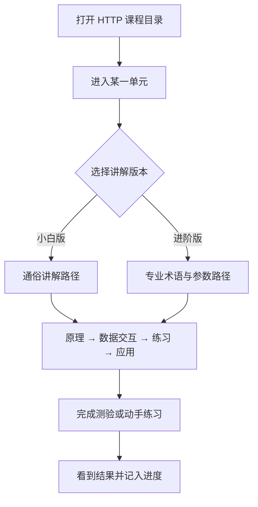

# HTTP 交互式学习（第一批）

## 1. 业务目标

自学技术的人面对 HTTP / 网络时，容易卡在「文字看懂了、过程对不上」。本期在仓库 `Izelzzz/interactive-tech-learning` 上交付固定课程的第一批单元：每个学习单元是可交互讲解，同一大纲提供小白版与进阶版两套讲解路径，用来对照纯文字阅读是否更能完成练习与测验。

成功状态可观察为：学习者能按所选版本走完「原理 → 数据交互 → 练习实践 → 应用场景」，并完成该单元配套小测验或动手练习；平台能统计完课与测验结果，供与纯文字材料对照。

**已确认：** 课程内容固定编写，不由学习者提问临时生成；大纲同构，差异在授课语言深浅；小白版与进阶版分开维护；第一批从 HTTP / 网络开刀。

**假设：** 共享同一交互骨架、文案分叉，可把制作成本压在可接受范围；完课率与测验正确率能作为「交互是否更有效」的对照指标。

**待确认（责任人：Izel；期限：第一批单元清单敲定前）：** 第一批具体单元清单（建议 3～5 个）与每单元必做练习形式（选择题测验 / 改参数看结果 / 写短代码）。

## 2. 业务结构

### 角色、场景与范围

- **角色：** 学习者（完全小白或已有一定基础）；课程编者（Izel 及协助写课的人）。
- **场景：** 学习者选择 HTTP / 网络课程中的某一单元，选小白或进阶讲解，完成交互讲解与练习。
- **本期包含：** 固定课程目录；学习单元的可交互讲解；小白版与进阶版两套路径；单元内小测验或动手练习；完课与测验结果可统计，便于与纯文字材料对照。
- **依赖项：** 第一批单元的正文与练习题由课程编者提供；学习者可在桌面或手机浏览器打开单元。

### 流程与路径

主路径：打开课程目录 → 进入某一 HTTP 单元 → 选择小白版或进阶版 → 按大纲完成原理、数据交互、练习、应用场景 → 提交测验或完成动手练习 → 看到对错或运行结果 → 记入完课进度。

## 3. 用户故事

1. 作为完全小白学习者，在学 HTTP 时需要用通俗语言走完同一大纲的交互讲解，以便在没有专业背景时也能跟上过程。
2. 作为有一定基础的学习者，在学同一单元时需要用专业术语、参数与流转细节走完讲解，并能动手改参数或写短代码看结果，以便把过程和输出对上。
3. 作为课程编者，在第一批只做 HTTP 时需要固定好单元大纲与两套讲解，以便对照完课与测验结果判断交互是否更有效。
4. 作为学习者，在单元结束时需要立刻做小测验或动手练习并看到结果，以便确认自己是否真的学会。

## 4. 功能清单

| 能力 | 业务规则 | 对应故事 | 备注 |
|------|----------|----------|------|
| 固定课程目录 | 学习者看到已发布的 HTTP 单元列表并可进入；内容由编者预先编写 | 故事 3 | |
| 版本选择 | 进入单元后可选择小白版或进阶版；两套路径分开维护、大纲步骤一致 | 故事 1、2 | |
| 交互讲解 | 每个版本按「原理 → 数据交互 → 练习 → 应用场景」推进；学习者可操作界面观察过程变化 | 故事 1、2 | |
| 小白讲解语气 | 小白版用通俗语言说明原理、过程与应用 | 故事 1 | |
| 进阶讲解语气 | 进阶版用专业术语说明参数、流转、输出与应用场景 | 故事 2 | |
| 单元练习 | 单元内提供小测验或动手练习（改参数看结果 / 写短代码），提交后立刻给出对错或运行结果 | 故事 4 | 形式待确认 |
| 进度与对照 | 记录所选版本、是否完课、测验或练习结果，供与纯文字材料对照 | 故事 3 | |

## 5. 边界与异常

| 情形 | 业务预期 |
|------|----------|
| 学习者未选版本就进入讲解 | 先要求选择小白版或进阶版，再进入正文 |
| 中途切换版本 | 可切到另一版本；进度按单元记录，版本切换可重新走讲解 |
| 测验答错或代码未通过 | 展示错因或失败结果，允许重试；完课条件按该单元规则判定 |
| 单元尚未发布 | 目录中仅展示已发布单元 |
| 移动端打开 | 讲解与练习可完成；交互控件适配小屏可读可点 |

## 6. 验收标准

1. 学习者能从目录进入至少一个已发布的 HTTP 单元，并完成小白版或进阶版整条大纲路径。（故事 1、2）
2. 同一单元的小白版与进阶版大纲步骤一致，讲解用语明显区分通俗与专业。（故事 1、2、3）
3. 单元内练习提交后，学习者立刻看到对错或运行结果。（故事 4）
4. 平台能读出该单元在所选版本下的完课与练习结果，便于对照纯文字材料。（故事 3）
5. 第 5 节各情形的业务预期即为该情形的验收。

## 7. 术语表

| 术语 | 在本规格中的含义 | 不包括 | 边界 |
|------|------------------|--------|------|
| 固定课程 | 编者预先写好、按目录发布的学习内容 | 学习者提问后临时生成整课 | 第一批为 HTTP / 网络 |
| 学习单元 | 课程中的一课，含讲解与练习 | 整门课的目录本身 | 建议第一批 3～5 个 |
| 小白版 | 同一大纲下用通俗语言讲解的路径 | 删减大纲步骤的缩略课 | 与进阶版大纲同构 |
| 进阶版 | 同一大纲下用专业术语与参数细节讲解的路径 | 另一门不同主题的课 | 与小白版大纲同构 |
| 可交互讲解 | 学习者可操作并观察过程变化的讲解 | 纯静态长文阅读 | 可用轻量交互，重动画非本期必选 |
| 完课 | 按该单元规则走完讲解并满足练习要求 | 仅打开过页面 | 具体练习形式待确认 |

## 8. 决策日志

| 时间 | 变更点 | 理由 | 决策人 |
|------|--------|------|--------|
| 2026-10-17 | 课程固定编写；交互式单元；小白 / 进阶双版本；大纲同构、讲法深浅不同 | 对照纯文字是否更有效；控制动画成本 | Izel |
| 2026-10-17 | 两套讲解分开维护；第一批从 HTTP / 网络开始 | 验证制作与学习效果 | Izel |
| 2026-10-17 | 新建仓库 `Izelzzz/interactive-tech-learning` 承载规格与后续实现 | 与既有实验仓分离 | Izel |
